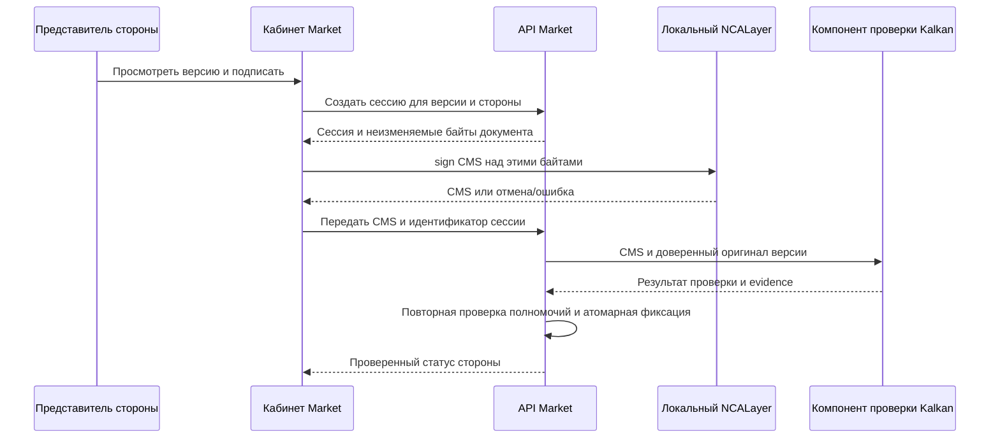

# Подписание документов ЭЦП НУЦ РК в Platforma Market

Создано: 15.10.2026. Актуализировано: 19.10.2026 после получения SDK владельцем.
Статус: техническая спецификация; SDK доступен, desktop-прототип SCOPED PASS,
пользовательская интеграция не принята. Единственный реестр исполнения — roadmap.
Связь с исполнением: R7.6.3.1–3 в [едином roadmap](../MAIN_ROADMAP_TO_PRODUCTION_2026-10-06.md).
Документ подготовлен по поручению владельца: описать реализацию и возможности
открытой документации. Он не разрешает автоматически реализацию, подключение
сервисов, подачу заявок, изменение рабочих данных или deployment.

## 1. Назначение и границы

**Утверждено владельцем19.10.2026:** в пилоте реализуется NCALayer desktop с
серверной проверкой и пользовательским UI. eGov QR / eGov Mobile / eGov Business,
мобильное подписание и нативные приложения отложены на последующие версии.
Мобильные исследования/ограничения ниже сохранены как будущий scope, не gate
пилотного desktop-пути. Это решение не объявляет рабочий адаптер готовым и не
ослабляет требования к полномочиям, доверию, отзыву, TSP и сохранению evidence.
Коды вручения — отдельное платформенное действие DWF-08/R7.6.6 вне пилота;
они не являются ЭЦП НУЦ. SMS авторизации/проверки номера не меняется.

Реализовать подписание неизменяемой версии документа собственной ЭЦП
уполномоченного представителя стороны, серверную проверку и архив доказательств.
Основной сценарий: поставщик подписывает товарную накладную фактической партии;
клиника после проверки товара подписывает ту же версию. Несколько подписей одного
поставщика не заменяют подпись клиники.

Продуктовые требования и исключения определены в
[MARKET_DOCUMENT_WORKFLOW](MARKET_DOCUMENT_WORKFLOW.md), краткие правила —
в [documents](documents.md). Этот документ детализирует технический путь,
не меняет формы документов, полномочия и порядок приёмки.
Подтверждение счёта не становится автоматически ЭЦП; акцепт общих условий
поставщика и договор реферала сохраняют собственные правила. Подпись накладной
не заменяет обязательный налоговый документ, оплату или комплектность сделки.

Предлагаемый первый путь: NCALayer на компьютере пользователя и серверная
проверка KalkanCrypt из официального SDK. Мобильный eGov QR — отдельный адаптер
после подтверждения доступа и контракта. Это архитектурное предложение;
реальная совместимость и окончательный профиль подписи подтверждаются прототипом.

Результат19.10 22:03: выбранный standalone Java Kalkan путь выполнен на Windows
и Linux/WSL2, реальная detached CMS NCALayer независимо проверена; trust/CRL/OCSP/TSP
и negative expiry/unavailable cases имеют scoped evidence в
[журнале](document-workflow-implementation-log.md) и
[инструкции прототипа](../../scripts/nca-prototype/README.md).
Это не развернутый verifier: таблица исходных приложений ниже сохраняет ограничения
production интеграции. Mobile API contract/access и реальная подпись не получены;
Mobile — POST_PILOT по решению19.10; desktop evidence — SCOPED PASS, рабочая интеграция открыта. Исторические NOT_RUN в инвентаризации описывают состояние
до выполнения прототипа; актуальные результаты ведутся в roadmap/журнале.

## 2. Источники и ограничения открытых материалов

Источники проверены в ходе исследования 15.10.2026:

| ID | Источник | Что подтверждает |
| --- | --- | --- |
| S1 | [НУЦ — разработчикам](https://pki.gov.kz/ru/developers/) | Порядок получения SDK владельцем ИС/представителем, контакты, OCSP/CRL/TSP, ссылки на правила проверки |
| S2 | [KNCA Basics Module](https://github.com/pkigovkz/sdkinfo/wiki/KNCA-Basics-Module) | Публичное описание sign, XML/CMS, параметров и фильтра сертификатов; страница имеет редакцию 2022 года |
| S3 | [NCALayerJSExample](https://github.com/pkigovkz/NCALayerJSExample) | Официальный пример HTML/JavaScript для Basics |
| S4 | [Kalkancrypt wiki](https://github.com/pkigovkz/sdkinfo/wiki/Kalkancrypt) | Идентификаторы и псевдонимы алгоритмов; не полный справочник серверной верификации |
| S5 | [Портал SDK](https://sdk.pki.gov.kz/) | Первичное и повторное получение комплекта |
| S6 | [NCALayer](https://ncl.pki.gov.kz/downloads/) | Официальная загрузка пользовательского приложения |
| S7 | [Каталог eGov Mobile](https://sb.egov.kz/services-catalogue?informationSystemLabel=Egov+Mobile&informationSystemValue=3) | Наличие NITEC-S-5096 EGOVMOBILE_QR_SIGN_SERVICE; владелец — АО «НИТ» |
| S8 | [Официальная SDK wiki](https://github.com/pkigovkz/sdkinfo) | Репозиторий содержит документацию, а не полный комплект библиотек |

Публично читаемая документация не равна open-source лицензии на SDK.
Условия использования и распространения каждого компонента проверяются отдельно.
Изучение протокола NCALayer и подготовка кода не требуют обращения за документацией.
Для выбранного пути KalkanCrypt официальный порядок предусматривает получение SDK;
это не доказательство обязательного отдельного разрешения на каждый документ.

Старая ссылка на паспорт NITEC-S-5096 из сообщения НУЦ при проверке показывала 404.
Сервис найден в текущем каталоге S7, но актуальные методы, условия подключения,
стоимость и подпись от имени юридического лица не подтверждены. Сторонние API
NCANode, SIGEX и другие обёртки не являются официальным API НУЦ и не считаются
выбранной заменой. Этот проект не вводит внешнего оператора ЭДО.

## 3. Что уже есть в исходниках

Первоначальная сверка: `2112e6a1fff5eff3a8a33b9ef29ead58455669ba`.
Повторная сверка 19.10: `main@cefdac4b3ea0615c7c8f6a34800a32d88077538a`.
Несвязанный незакоммиченный UI/CI/docs WIP сохранён, не является evidence ЭЦП.
Счёт, предпросмотр накладной, операционный довоз и рабочие документы довоза уже
имеют отдельные реализации. Их наличие не подтверждает подписанный оригинал.

| Компонент | Факт | Недостающее доказательство |
| --- | --- | --- |
| [eds-client](../../packages/eds-client/src/index.ts) | WebSocket NCALayer, запрос detached CMS, таймаут и обработка ответа | Реальная подпись актуальным сертификатом; точная форма ответа, совместимость ОС/браузеров |
| [EdsSignatureVerificationService](../../apps/api/src/modules/agreements/eds-signature-verification.service.ts) | Вызов gateway `/verify`, проверка evidence, checksum, БИН и срока сертификата | Реальный криптографический verifier, привязка к оригинальным серверным байтам, доверие/отзыв/TSP |
| [SignatureAdapter](../../apps/api/src/modules/documents/signature-adapter.ts) | Контракт сессии и вызов gateway `/sessions` | Контракт полноценного внешнего исполнения и reconciliation |
| [Registry](../../apps/api/src/modules/documents/signature-adapter-registry.service.ts) | Выбор адаптера; mock при отсутствии gateway вне production | Production readiness и запрет ложного результата в реальном пользовательском пути |
| [Журнал исследования](document-workflow-implementation-log.md) | Предварительная сверка НУЦ 14.10, реальный прототип NOT_RUN | Внешнее evidence R7.6.3.1 |

`SIGNATURE_GATEWAY_URL`, `/sessions` и `/verify` — интерфейсы нашей интеграционной
границы, не публичные REST endpoints НУЦ. Готового Kalkan verifier в просмотренных
исходниках не установлено. Наличие enum EDS/EGOV_QR и unit PASS не доказывает интеграцию.

Сверка 19.10: вызовы NcalayerClient найдены в tests/unsigned prototype, но не в
пользовательских приложениях. `/verify` передаёт CMS, checksum, session и ожидаемый
БИН без оригинальных байтов; контракт доверенного получения оригинала предстоит
реализовать. DocumentsService запрещает подпись WAYBILL_PREVIEW и RESUPPLY_PREVIEW.
Эти guards снимаются только для нового принятого пути выпуска окончательной версии,
а не ради демонстрации подписи черновика. Схема результата пока не требует отдельного
проверенного ИИН/роли/основания полномочий и структурированного TSP evidence.

## 4. Подготовка по открытым материалам и изменение доступности

Таблица сохраняет границу первоначальной подготовки 15.10. С 19.10 SDK и тестовые
входы получены (§10); прежнее отсутствие комплекта больше не блокирует прототип.
Это не означает, что выполнены перечисленные runtime-проверки.

| Работа | Можно по открытым материалам | Ограничение результата |
| --- | --- | --- |
| Клиент NCALayer, CMS-запрос, выбор языка, ошибки и отмена | Да, S2/S3; существующий клиент дорабатывается по необходимости | Mock WebSocket не доказывает реальную подпись |
| Предпросмотр и фиксация версии документа | Да, собственный код платформы | Формы и полномочия следуют продуктовому workflow |
| Сессия подписания, tenant guards, idempotency, архив | Да, собственная реализация | Это не криптографическая проверка |
| Контракты Zod/OpenAPI/api-client и интерфейс verifier | Да | Тестовый ответ явно отделён от production |
| Тесты неверной стороны, версии, повторов и гонок | Да, на изолированных fixtures | Реальные CMS/OCSP/TSP требуют отдельной проверки |
| Подпись в установленном NCALayer | Протокол открыт, приложение доступно | Нужен допустимый ключ; для воспроизводимого прототипа — тестовые сертификаты |
| KalkanCrypt verification на сервере | Архитектуру можно подготовить | Для исполнения нужны актуальные библиотеки SDK и подтверждённые условия использования |
| Проверка OCSP/CRL и TSP | Адреса доступны в S1 | Доступность URL не подтверждает криптографическую проверку ответа и свежесть |
| eGov QR | Можно выделить адаптер и UX-состояния | Нельзя изобретать API, обещать доступ или выдавать заглушку за мобильную подпись |

Результат этапа по открытой документации: проверенная внутренняя основа с явно
недоступным реальным подписанием при отсутствии verifier. Это не production release
ЭЦП и не закрытие R7.6.3. Интерфейс не показывает «Подписано» по mock evidence.

## 5. Архитектура и подписываемый объект



Сохраняется modular monolith: доменная логика документов остаётся в API Market.
Если SDK требует Java/native runtime, криптография может исполняться отдельным
внутренним процессом за текущей границей gateway. Это техническая изоляция
библиотеки, а не перенос владения документами во внешний сервис.

Предлагается подписывать точные байты окончательного PDF отделённой CMS-подписью.
Оригинал не перегенерируется после первой подписи. Вторая сторона подписывает те же
байты; подписи хранятся отдельно со своей стороной и evidence. Конкретное объединение
подписей для экспорта и профиль CAdES согласуются по результатам прототипа.
Не обещать PAdES, встроенную подпись Adobe или архивный уровень LT/LTA из факта CMS.

SHA-256 в модели Market — контрольная сумма версии. Она не подменяет алгоритм
подписи сертификата НУЦ. Передавать её вместо документа при `digested=false` нельзя.
Для проверки detached CMS verifier получает оригинальные байты из доверенного
хранилища либо защищённую внутреннюю ссылку на конкретную версию. Одной присланной
браузером суммы SHA-256 недостаточно. Произвольный URL от пользователя не допускается.

## 6. Браузерный протокол

Существующий клиент использует `wss://127.0.0.1:13579/`. Начальный запрос по S2:

```json
{
  "module": "kz.gov.pki.knca.basics",
  "method": "sign",
  "args": {
    "format": "cms",
    "data": "BASE64_OF_EXACT_DOCUMENT_BYTES",
    "signingParams": {
      "decode": true,
      "encapsulate": false,
      "digested": false,
      "tsaProfile": {}
    },
    "signerParams": { "extKeyUsageOids": ["1.3.6.1.5.5.7.3.4"] },
    "locale": "ru"
  }
}
```

Это шаблон запроса, не запись успешного вызова. `tsaProfile` по документации
запрашивает метку времени; наличие и корректность метки проверяются на сервере.
Фильтр OID помогает выбирать ключ и не доказывает полномочия представителя.
Точную схему ответа, поддержанные версии, размеры документов, таймауты и поведение
при отмене зафиксировать по реальному SDK/NCALayer. Не считать все предполагаемые
поля ответа поддержанными только потому, что текущий клиент умеет их извлекать.

Ключ и пароль не загружаются в Market, не сохраняются в логах и не запрашиваются
на нашей форме. Не обходить локальные TLS/браузерные ограничения. Для отсутствующего
NCALayer показать установку/запуск и повтор действия; проверить разрешённые браузеры
и ОС. UI использует shared adapters/tokens по DESIGN_SYSTEM при реализации.

## 7. Проект доменных контрактов

Ниже логические операции, не утверждённые новые HTTP-маршруты. Сначала сверить
существующие API документов/договоров; расширять их через packages/schemas,
OpenAPI и api-client без параллельных несовместимых DTO.

| Операция | Вход и серверный контекст | Результат и инварианты |
| --- | --- | --- |
| Начать подписание | documentVersionId, ожидаемая версия состояния, способ, idempotency key; actor/tenant из сессии | Сервер определяет сторону, права, checksum, план подписей, срок; повтор того же запроса возвращает ту же сессию |
| Получить оригинал | sessionId и текущий actor | Только версия и сторона, разрешённые сессией; контроль доступа перед выдачей |
| Отправить подпись | sessionId, CMS, idempotency key | Ограничение размера/формата; durable receipt; проверка не означает автоматический commit |
| Прочитать результат | sessionId | Авторизованный snapshot: ожидание, проверка, успех, отказ или неизвестный исход |
| Отменить ожидание | sessionId и версия состояния | Локальная отмена не удаляет уже проверенную подпись; гонка с commit обрабатывается атомарно |
| Восстановить результат | sessionId/provider reference | Дедупликация поздних событий, повторная проверка актуальности и полномочий |

Минимум сессии: actorId, tenant/organizationId, требуемая сторона, documentVersionId,
server checksum, signing method, signing plan version, authority reference/version,
createdAt/expiresAt, idempotency key, provider reference, состояние и версия записи.
Данные сертификата извлекаются verifier, а не принимаются как доверенные от браузера.

Проект состояний: READY → AWAITING_USER → VERIFYING → VERIFIED; отдельно CANCELLED,
EXPIRED, REJECTED, UNKNOWN. Состояние документа вычисляется по обязательным сторонам.
Недоступность verifier/OCSP означает «проверка не завершена», а не «подпись неверна».
Повторный POST после таймаута сначала сверяется с сохранённым результатом.

Поздний результат сохраняется для аудита; устаревшая версия, отозванные полномочия
или отменённая сессия не позволяют автоматически закрыть документ. Решение о принятии
истёкшей сессии должно быть явно определено контрактом, безопасный default — отказ
в автоматическом commit и новое действие пользователя. Уже принятая подпись не теряется
из-за потери ответа клиенту. Внутренний cancel не отзывает криптографическую подпись.

## 8. Серверная проверка и фиксация

Конкретный проект пилотной накладной и API/UI-карты — [DWF §18](MARKET_DOCUMENT_WORKFLOW.md#pilot-waybill-contract).
Решение владельца19.10: допускаются руководители и уполномоченные сотрудники
обеих сторон. Механизм подтверждения основания сотрудника и идентичности
руководителя ещё не принят; существующий document.sign сам по себе его не заменяет.
Сверка30a0ab7: DocumentSignature содержит свободный JSON evidence и nullable
signer IDs, createSignatureSessionSchema принимает выбранные клиентом IDs,
а local session фиксирует checksum. Нет типизированного authority snapshot,
неизменяемого плана сторон и полного контракта independent verification/commit.
Существующие проверки доступа не удаляются; новые доверенные actor/tenant
выводятся из auth context. Запрет подписи WAYBILL_PREVIEW сохраняется до выпуска
принятой окончательной формы; изменение документации не разрешает его снять.

Verifier обязан проверить структуру контейнера, подпись над доверенным оригиналом,
разрешённые алгоритмы, цепочку до доверенного корня, назначение и срок сертификата,
статус отзыва и корректность TSP. Фактическая реализация следует актуальным правилам
НУЦ из SDK/S1. Тестовые trust anchors изолированы от production.

Для OCSP/CRL проверять подпись ответа/списка и свежесть; недоступность OCSP не
разрешает безусловно принять сертификат. Политика fallback на актуальный CRL,
таймауты и допустимая свежесть фиксируются по SDK и правилам, не придумываются здесь.
Сетевые адреса сертификатов не дают неограниченный outbound: использовать проверенные
источники и существующую политику OutboundRequestGateway, лимиты времени/ответа.

После криптопроверки API повторно проверяет сторону, организацию, представителя,
основание и срок полномочий, актуальность версии и плана подписей. Проверка только
БИН недостаточна. ИП и иные формы сторон должны иметь явное сопоставление идентичности;
текущий BIN-only контракт не объявляется универсальным.

Криптографические сетевые операции выполняются вне длинной транзакции. В короткой
транзакции с optimistic version/блокировкой повторяются доменные guards, добавляются
подпись/evidence, audit и outbox, пересчитывается статус сторон. Unique constraints
защищают от повторного commit. При конкурентном отзыве полномочий или смене версии
операция отклоняется целиком. Повторный callback не создаёт второе событие принятия.

Результат verifier содержит не один boolean, а отдельные результаты signature,
content match, trust, certificate validity, revocation, timestamp, проверенное время,
идентификатор сертификата/подписанта, алгоритмы и версию verifier/policy. Отказ,
неизвестность и временная недоступность различаются. Точные поля утверждаются после
прототипа; неподтверждённые поля не заполняются фиктивными значениями.

## 9. Архив и пользовательские состояния

Хранить оригинал версии, каждую CMS, сертификаты/цепочку, TSP и использованные
доказательства статуса отзыва, результаты проверки и версию политики, план сторон,
снимок основания полномочий, session/provider IDs и журнал событий. Обеспечить
разграничение доступа, резервирование и проверку восстановления. Сроки хранения,
повторная верификация и состав долгосрочного пакета утверждаются отдельно;
наличие метки времени не гарантирует автоматически бессрочную проверяемость.

Исправление создаёт новую связанную версию/документ со своим планом подписей.
Оригинал и прежние подписи остаются в истории; перезапись подписанного PDF запрещена.
Скачивание для сторон включает оригинал и подписи с понятным описанием проверки.
Персональные данные сертификатов доступны только по роли и необходимости;
в технических логах — идентификаторы/коды, без закрытых ключей, паролей и полного документа.

В UI разделять «поставщик подписал», «ожидается подпись клиники», «проверяется»,
«подписано обеими сторонами», «требуется исправление». Предусмотреть loading,
недоступный NCALayer, отмену, истёкшую сессию, неверную сторону, stale version,
недоступный verifier и неизвестный исход с повторной проверкой. При возвращении
на страницу состояние читать с сервера; не терять документ после закрытия окна.
Клиника не получает ложную полную приёмку при частичной поставке/расхождении.
Оператор видит причину и допустимое восстановление, но не может вручную объявить
непроверенную подпись действительной или подписать от имени клиники.

## 10. Полученный SDK и мобильное подключение

19.10 владелец сообщил о скачивании официального SDK; проведена статическая
инвентаризация 577 файлов (260430316 байт), README, changelog, примеров, DOCX API
и содержимого JAR. Локальный источник: `C:/Users/user/Downloads/SDK`, вложенный
корень `SDK/SDK/SDK/SDK 2.0`. Этот путь — вход текущей машины, не production config.
Библиотеки и ключи не копировать в Git; воспроизводимость обеспечить manifest
версий/хешей выбранных артефактов и разрешённым способом доставки зависимостей.

| Материал | Найдено | Граница вывода |
| --- | --- | --- |
| Java provider | 0.7.8-current, 0.7.6-certified | Выбор runtime/версии требует прототипа; названия не означают сертификацию Market |
| Java utilities | 0.8.5; CMSUtil, PKIXUtil, X509Util, OCSPUtil, TSPUtil, Verifier; trust stores | Подходящие API есть; зависимости и фактические результаты не проверены исполнением |
| Linux C | 2.0.14 в C_libs.zip, VerifyData/X509ValidateCertificate и пример | Альтернатива Java; проверить native dependencies/архитектуру и упаковку |
| Windows COM / PHP | Библиотеки и примеры | Не основной выбранный кандидат для NestJS/Linux |
| NCALayer | README рекомендует basics; commonUtils помечен deprecated | Точный ответ/отмена/совместимость браузера доказываются реальным вызовом |
| Тестовые сертификаты | ГОСТ 2015, ЮЛ/физлицо, руководитель/сотрудники, valid/revoked; CA и CRL | Названия каталогов не заменяют проверку содержимого и текущего статуса |
| Тестовые сервисы | README: http://test.pki.gov.kz/ocsp/ и http://test.pki.gov.kz/tsp/, ссылки на CA/CRL | Наличие адресов не подтверждает доступность или корректность ответа |

В журнале SDK последняя запись 23.07.2026. JavaDoc помечен deprecated; Linux README
ссылается на 1.1.1 при наличии 2.0.14. Тестовый utils — 0.8.0.TEST, основной — 0.8.5.
Сверять сигнатуры методов с выбранной библиотекой, не копировать примеры вслепую.
В C-документации checkTime для X509ValidateCertificate обозначен неиспользуемым;
историческую проверку нельзя обещать по одному этому параметру.

Кандидат для прототипа: Java KalkanCrypt + utilities за существующей внутренней
границей verifier, без переноса доменной логики из NestJS. До исполнения определить
JDK, зависимости, образ/ОС, версии и контрольные суммы; доказать запуск на целевом
Linux-профиле. При несовместимости обоснованно выбрать C-вариант, не вести две
реализации параллельно. Выбор runtime фиксируется результатом прототипа.
Готовые Node.js binding и REST `/verify` в комплекте не найдены.

Тестирование — в отдельном профиле NCALayer/окружении и disposable DB, без изменения
рабочих ключей/доверенных корней. Инструкция TEST utils предлагает замену файла
в cache NCALayer: не выполнять её в профиле реального подписания компании.
Публичные тестовые ключи используются только как fixtures вне Git; реальные ключи
и пароли не читать/копировать для прототипа. Подлинность выбранных SDK binaries,
условия использования/распространения и обновлений проверить до production упаковки;
отдельного общего лицензионного документа Kalkan в изученном наборе не найдено.
Контакты S1: info@pki.gov.kz — получение; knca@pki.gov.kz — технические уточнения.
SDK не трактуется как сертификация всей системы или автоматическое разрешение всех
юридических сценариев. За корректность реализации отвечает владелец ИС.

Для NITEC-S-5096 отдельно подтвердить актуальный паспорт, условия/стоимость доступа,
поддержку ЮЛ/ИП и представителей, формат подписываемых данных/результата,
callback/polling и их аутентификацию, idempotency, срок сессии, отмену и late result,
лимиты и мобильный переход на том же устройстве. Контакт портала Smart Bridge:
sb.egov@nitec.kz. Не заменять этот контракт сторонним QR-примером без отдельного выбора.

## 11. Последовательность реализации и доказательства

Это техническая декомпозиция существующего R7.6.3, не отдельный backlog.

| Этап | Результат | Критерий завершения |
| --- | --- | --- |
| Подготовка / полученный SDK | Существующая основа и инвентаризация §3/10 | Подготовка есть, SDK доступен; реальные подписи NOT_RUN |
| R7.6.3.1 реальный прототип | Зафиксированные версии SDK/NCALayer, известный оригинал и настоящая тестовая CMS | Подпись принимается только над оригиналом; проверены другая сторона, изменённые байты, доверие/отзыв/TSP; ограничения записаны |
| R7.6.1.2–3 относящаяся к подписи часть | Утверждённая форма выбранного документа, полномочия и version/party/evidence contract | Продуктовые решения отделены от инженерного выбора; schemas/OpenAPI/client и UI states согласованы до зависимой реализации |
| R7.6.3.2 реализация | Проверенный verifier, commit, evidence, recovery | Backend проверки после каждого связного перехода; tenant/roles/race/replay/rollback доказаны в изоляции |
| R7.6.3.3 интерфейс | Предпросмотр → NCALayer → серверный результат и доступные доказательства | Реальная CMS проверена сервером; browser flow, screenshot/computed styles, ошибки, отмена и повтор |
| R7.6.4.2–3 применение к накладной | Окончательная версия → подпись поставщика → подпись клиники той же версии | План разных сторон, количество партии, запрет устаревшей версии и повторного движения товара; полный архив завершается в R7.6.7 |
| Мобильный путь | Адаптер подтверждённого eGov QR | Реальные тестовые сессии, обе стороны и поздние результаты; отдельное evidence от desktop |

Минимальные сценарии приёмки: две разные стороны одной версии; чужой tenant;
сертификат другой организации; отсутствие полномочий и конкурентный отзыв;
изменение одного байта; неподходящий/просроченный/отозванный сертификат;
недоверенная цепочка; недоступный или устаревший revocation response;
некорректная/отсутствующая обязательная TSP; duplicate submit/callback;
потеря ответа после commit; отмена/expiry/late result; конкурентная новая версия;
повреждённый/слишком большой контейнер; восстановление архива; запрет mock в live path.

Численные лимиты, retry/backoff и эксплуатационные сроки фиксируются по измерениям
прототипа и доступному контракту. Не проводить эти тесты на рабочих документах
или реальных ключах сотрудников. Fixtures/БД должны быть изолированы.
Реализация требует scoped typecheck, целевых тестов и применимых PostgreSQL/runtime/
production gates по Workflow; общая release-проверка нужна в границе выпуска.

### 11.1 Исполнимый пакет прототипа R7.6.3.1

Вход: SDK §10, synthetic original/modified из prepare-nca-prototype.mjs,
тестовые сертификаты и отдельное доверие. Прежний unsigned packet не содержит CMS
и не является результатом криптопроверки. Боевые формы и завершение Admin не нужны
для synthetic-прототипа; они не подменяются тестовым документом в рабочем сценарии.

1. Зафиксировать manifest: SDK artifacts/SHA-256, NCALayer/module, verifier/runtime,
   ОС/браузер, trust anchors, test endpoints, время запуска, конфигурацию без секретов.
2. Выполнить реальный basics/sign над известными байтами. Сохранить CMS, точный
   обезличенный ответ, оригинал, checksum, timestamp и результат отмены.
3. Проверить CMS серверной библиотекой над доверенным оригиналом. Раздельно доказать
   криптографию, цепочку, назначение, срок, отзыв, TSP; не отключать trust ради PASS.
4. Прогнать негативные случаи: изменённый байт/CMS, другая организация, неподходящая
   роль/назначение ключа, просрочка, отзыв, недоверенный корень, unavailable/stale
   revocation, повреждённый/отсутствующий обязательный TSP. Для отсутствующего fixture
   записать NOT_RUN и способ его получения; не имитировать реальный crypto PASS.
5. Зафиксировать профиль detached CMS/CAdES, алгоритмы, ограничения размера/таймаутов,
   формат результата, зависимости и безопасную политику отказа. Измеренные значения
   становятся входом контракта, а не придумываются заранее.

Выход: воспроизводимая команда прототипа и manifest результатов по каждому сценарию,
ссылки на локальные evidence в журнале документооборота, версия кода и ограничения.
Desktop может получить отдельный scoped PASS; mobile остаётся OPEN/NOT_RUN, пока
не подтверждены доступ и реальная сессия. Это не закрывает mobile или весь R7.6.3.

### 11.2 Контракт verifier и граница принятия

В R7.6.1.3 определить запрос: session/document version, доверенные оригинальные
байты либо внутренний immutable reference, CMS, server checksum, policy version.
Идентичность ожидаемой стороны задаёт API, а не браузер. Внутренний канал имеет
аутентификацию, ограничения размера/времени и закрытый доступ; внешние URL запрещены.
Verifier не меняет заказ/документ и не распоряжается ключами пользователя.

Ответ: результаты каждой проверки из §8, извлечённая идентичность/сертификат,
время и версия политики, ссылки/хеши сохранённых доказательств и код причины.
Отдельные исходы: VERIFIED, INVALID, INDETERMINATE; временный сетевой сбой не INVALID.
Это логические значения для согласования со схемами, не утверждение уже имеющихся API.
Для новой подписи проверять текущую допустимость, для старого архива определить
историческую политику отдельно: истечение сертификата сегодня не переписывает
зафиксированный исторический результат автоматически.

| Пакет проверки | Что доказывать | Где фиксировать |
| --- | --- | --- |
| SDK prototype | Реальные CMS, integrity/trust/revocation/TSP и измеренные ограничения | R7.6.3.1 manifest и журнал |
| Контракты | Request/response/errors, роли/стороны/версии, совместимость старых записей | R7.6.1.3 schemas/client/OpenAPI tests |
| Backend | Каждая связная операция, happy/invalid/denial; atomic commit, rollback, race/replay/recovery | R7.6.3.2 focused tests + изолированный PG; migration upgrade при изменении schema |
| UI | Реальный NCALayer flow и серверный результат, cancel/unavailable/unknown/reload; desktop и честное ограничение mobile | R7.6.3.3 targeted browser + visual evidence; mocks отдельно от live receipt |
| Накладная | Две требуемые стороны той же партии/версии, stale/authority revoke, неизменность stock/money | R7.6.4.2–3 dependent API/PG/browser |
| Архив/выпуск | Оригинал/CMS/evidence восстановимы, test trust/mock исключены, production config | R7.6.7, R8/R9; не заявлять из prototype PASS |

Перед каждой реализацией выбрать реальные scoped scripts по Workflow, окружение,
fixtures и лимит попыток; не превращать эту таблицу в безусловный полный E2E запуск.

## 12. Открытые решения и статус этой задачи

До production определить: профиль CMS и экспорт двух подписей, технический runtime
verifier, актуальные версии SDK, правила проверки/хранения evidence, полномочия
представителей разных организационных форм, формы исправлений и условия eGov QR.
Юридическая пригодность конкретного документа и его формы проверяется с юристом;
эта спецификация не объявляет любую CMS автоматически достаточной для всех сделок.

Выполнено 15.10: первоначальная спецификация по открытым материалам.
Выполнено 19.10: инвентаризация полученного владельцем SDK и актуализация
последовательности/критериев исполнения. Блокер отсутствия SDK снят; desktop
прототип можно начинать по следующему поручению. Боевые формы/полномочия остаются
входом зависимой реализации, мобильный доступ — отдельным открытым вопросом.
Проверки docs-only: локальные ссылки, согласованность с workflow/кодом,
отсутствие секретов и diff hygiene. Реальные подписи не создавались, SDK binaries
не запускались, runtime tests не выполнялись. R7.6.3 остаётся открытым.
