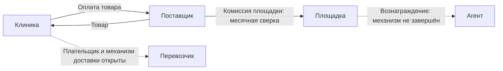

# PlatformaMarket: финансовая модель и полный жизненный цикл B2B-заказа

## Граница справочника после синхронизации 29.10.2026

Ниже сохранён статический разбор runtime23.10 и прежних решений, с его формулами/
ссылками. Он не является текущим контрактом новых P1–P7/B2C/агентов/доставки.
Действующие требования — [объединённое ТЗ Market](../UNIFIED_SPEC_MARKET_REQUIREMENTS_2026-10-29.md), реализация — R0–R9.
Новые отличия: P1 семь дней без резерва, optional proof, paid-part/proposal28А,
отдельные прямые payments26А и отдельная доставочная сумма Platforma; комиссия10%
с пятидневным принципом комплекта+отправки; supplier-agent90суток/ставка OPEN/42А;
автономная финпанель Market. Старые1% клиник/30мин reserve/полная оплата всего заказа
описывают историческую основу и не должны повторно внедряться как новое ТЗ.
Подтверждённый security/W1 статус — ffddb74 и CI/Security5be8417 SUCCESS; финансовую
модель/production/provider acceptance эти исправления не завершили.

Дата анализа: **23 октября 2026 года**. База кода: **main@76505432bff1afd6d7a2771d30778c8744ebe9d7**.

Документ подготовлен по поручению владельца: подробно описать путь юридического
лица клиники от регистрации до отгрузки и доставки, движение денег, правила
площадки, существующую реализацию и оставшуюся работу. Это описание состояния
продукта и кода на указанной версии. Оно не вводит новые бизнес-правила, не
сертифицирует production и не заменяет бухгалтерское или правовое заключение.

Приоритет требований сохраняют [функциональная карта](../FUNCTIONAL_AUDIT_AND_ROADMAP_2026-10-08.md)
и [PROJECT_OVERVIEW](../PROJECT_OVERVIEW.md). Единственный реестр исполнения —
[Main Roadmap R0–R9](../MAIN_ROADMAP_TO_PRODUCTION_2026-10-06.md).
Этот документ связывает существующие области в один сценарий, а не создаёт
параллельный backlog. Последние результаты документов и подписанта необходимо
читать вместе с [журналом реализации](document-workflow-implementation-log.md):
обобщённые статусы ранних строк roadmap могут быть менее подробными.

## Содержание

1. [Итог анализа и границы готовности](#summary)
2. [Участники, договоры и денежные потоки](#parties)
3. [Регистрация клиники и допуск участников](#registration)
4. [Реквизиты, полномочия и электронная подпись](#identity)
5. [Предложение, цена, налоги и акции](#pricing)
6. [Корзина, checkout и резерв](#checkout)
7. [Подтверждение заказа поставщиком](#confirmation)
8. [Счёт и ручная банковская оплата](#manual-payment)
9. [Провайдерская оплата и расхождение финансовых моделей](#provider-payment)
10. [Сборка, отгрузка, доставка и получение](#delivery)
11. [Недостача, довоз, отмена и возврат](#exceptions)
12. [Комиссия, аналитика, расчёты и рефералы](#commission)
13. [Документальное и финансовое закрытие](#closure)
14. [Сущности, API, интерфейсы и инварианты](#architecture)
15. [Сквозные расчётные примеры](#examples)
16. [Что осталось реализовать и доказать](#gaps)
17. [Основания, проверки и сопровождение](#evidence)

<a id="summary"></a>

## 1. Итог анализа и границы готовности

PlatformaMarket уже содержит существенную внутреннюю B2B-цепочку: создание
организации, разграничение доступа, предложения поставщиков, корзину с повторной
проверкой условий, разделение заказа по поставщикам, резервы, подтверждение
состава, счёт, сообщение об оплате, подтверждение поступления поставщиком,
отгрузки, фактическое получение, часть исключений и событийную аналитику.

Однако **сквозная коммерческая готовность для реальных участников ещё не
доказана**. Существование кнопки, таблицы БД или адаптера не подтверждает
договорённость банка, выполнение перевозчиком, юридическую пригодность всего
комплекта документов или получение дохода площадкой.

| Область | Что есть на базе анализа | Граница результата |
| --- | --- | --- |
| Регистрация | Intent, подтверждённая учётная запись, организация, владелец, membership, акцепт условий | Регистрация сама по себе не подтверждает полномочия подписанта |
| Покупка | Цена, freshness, snapshots, revalidation, checkout, supplier orders, резервы | ERP и живые источники принимаются отдельно |
| Ручная оплата | Счёт, квитанция, подтверждение поставщика, частичные суммы, переплата, проверки и возвраты | Банковское поступление вводится участником; автоматическая банковская сверка этим не доказана |
| Provider payment | Intent, allocations, authorize/capture/cancel/refund, ledger, payout, webhook | Общий технический контур; выбранный банк и принятая коммерческая модель не завершены |
| Доставка | Правила стоимости, отправления, этапы, частичная приёмка, tracking-поля | Не равнозначно заказу услуги и подтверждённым событиям СДЭК/Жанапост |
| Комиссия | Начисление 10% на фактически полученный товар, корректировка при возврате | Полученная комиссия и долг пока не рассчитываются как законченный расчётный контур |
| Документы | Реквизиты, сгенерированный счёт, preview накладной, история, части НУЦ/допуска | Полная двусторонняя подпись партии и документальное закрытие ещё не приняты |
| Рефералы | Принято правило 1% и ежемесячность | Полного цикла атрибуции, начисления и выплаты нет |

Главные выявленные расхождения:

- Принятая комиссия — **10% полученного товара с месячной сверкой**. Provider
  pipeline содержит отдельный расчёт **2% при capture** и проводки удержания/
  выплаты. Эти механики нельзя считать двумя описаниями одного готового решения.
- Цена доставки может быть рассчитана отдельным quote, но не включена в
  `SupplierOrder.subtotalAmountMinor` и не образует законченный расчётный поток.
- Операционная отгрузка проверяет оплату и складские ограничения, но в
  исследованном пути не требует завершённой подписи накладной.
- `PAID`, `DELIVERED`, подписанный документ, полный комплект и оплаченная
  комиссия — разные результаты. Единого доказанного «всё закрыто» пока нет.

### 1.1 Как читать статусы

**Принято** — решение владельца зафиксировано в действующих документах.
**Реализовано** — найдены соответствующие контракт и исполняемая логика.
**Проверено** — существует evidence с конкретной версией, профилем и границей.
**Внешне подтверждено** — есть отдельное доказательство банка, перевозчика или
другого внешнего участника. **Открыто** — требуется решение или завершение.

В этом анализе код читался статически. Новые банковские операции, тестовые
покупки, миграции и изменения рабочих данных не выполнялись. Существующие PASS
упоминаются только в своих границах; они не перенесены на весь финансовый цикл.

<a id="parties"></a>

## 2. Участники, договоры и денежные потоки

### 2.1 Кто за что отвечает

| Участник | Действия и ответственность | Что нельзя автоматически приписать участнику |
| --- | --- | --- |
| Клиника — организация BUYER | Покупает, принимает состав и условия, платит, сообщает фактическое получение, заявляет расхождения | Пользователь кабинета не обязательно законный подписант всех документов |
| Поставщик — организация SUPPLIER | Публикует предложения, подтверждает состав, выставляет счёт, подтверждает деньги на своём счёте, отгружает | Создание квитанции покупателем не заменяет его подтверждение поступления |
| Площадка/оператор | Организует взаимодействие, проверяет допуск, ведёт аудит и поддержку, начисляет собственную комиссию | Не становится продавцом товара и держателем покупной суммы только из-за наличия ledger |
| Банк/PSP | Выполняет реальные платёжные операции в согласованном продукте | Успех mock или общего HTTP-адаптера не доказывает поддержку банковского split |
| Перевозчик | Выполняет доставку по выбранным условиям | Введённый tracking number не доказывает приём груза перевозчиком |
| Агент | Привлекает участников в рамках договора и согласованной атрибуции | Право на вознаграждение не даёт доступ к данным привлечённой клиники |

### 2.2 Принятая схема денег

Покупатель платит **поставщику напрямую**. Площадка не должна принимать всю
покупную сумму на собственный счёт, чтобы затем распределять её поставщику и
перевозчику. Целевая единая оплата мультипоставщицкой корзины предполагает
банковское распределение денег по поставщикам. Переговоры с Freedom Bank
Казахстан зафиксированы, но поддержка нужного продукта ещё не подтверждена.

Отдельно существуют собственные расчёты площадки с поставщиком по комиссии и
расчёты с агентом. Они не должны незаметно смешиваться с оплатой товара.



Пунктир показывает незавершённый механизм, а не утверждённую схему списания.
В частности, стрелка к перевозчику не назначает клинику обязательным плательщиком.

### 2.3 Какие договорные основания различаются

1. Условия использования площадки и согласия при регистрации.
2. Обязательное договорное основание **площадка — поставщик**, актуальные
   supplier terms и коммерческий допуск поставщика.
3. Сделка **клиника — поставщик**. Наличие рамочного договора поддерживается,
   но не является единственной формой: код различает `FRAMEWORK_AGREEMENT` и
   `ONE_TIME`.
4. Документы конкретной поставки: счёт, накладная партии, документы исключений.
5. Договор площадки с агентом; это самостоятельная цепочка R6.

Счёт на товар не является счётом площадки на комиссию. Принятие условий
поставщиком не подписывает автоматически будущие накладные. Подтверждение оплаты
не закрывает документальную часть сделки.

Основания: [оплата](payments.md), [комиссии](commissions.md),
[организации](organizations.md), [договоры](documents.md).

<a id="registration"></a>

## 3. Регистрация юридического лица клиники

### 3.1 Заявка на регистрацию

В [OnboardingService](../../apps/api/src/modules/onboarding/onboarding.service.ts)
регистрация начинается с intent. Он связывает email, БИН и тип организации;
повторный запрос обрабатывается с учётом идемпотентности. Проверяется отсутствие
уже созданной организации с тем же БИН и конфликтующей активной заявки.

Сервис выдаёт токен из 48 случайных байтов, хранит SHA-256 токена и ограничивает
срок действия 24 часами. При допустимом повторе токен обновляется. Это защищает
продолжение регистрации; токен не является подписью юридического лица.

В intent сохраняются версия согласия, даты принятия условий и privacy,
технический контекст IP/user-agent, маркетинговое согласие и источник. Эти
сведения позволяют восстановить действие пользователя, но не заменяют
проверенный юридический оригинал договора.

Особенность текущей реализации: `offerDocumentHash` вычисляется из строки
`DentMarket platform offer:` и версии согласия. Это **не хеш фактических байтов
PDF или текста юридического документа**. Поэтому наличие этого поля нельзя
описывать как доказательство неизменности конкретного юридического файла.

### 3.2 Завершение регистрации

При claim проверяются статус и срок intent, токен и соответствие email
подтверждённой identity. Создание бизнес-сущностей выполняется транзакционно:

- организация с capability `BUYER` для клиники или `SUPPLIER` для поставщика;
- принадлежность к `commerceDataset=BUSINESS`;
- профиль поставщика, если выбрана соответствующая capability;
- роль владельца с разрешениями и активное членство пользователя;
- запись принятия условий площадки;
- audit/outbox-события;
- при настроенном пилотном плане — trial-подписка с `billingEnforced:false`.

Если транзакция не завершилась, частично созданная организация не должна
выдаваться как успешная регистрация. Пилотный trial не означает начисление
платной подписки: принятой моделью дохода пилота остаётся комиссия.

Development completion существует как ограниченный непроизводственный путь
для локального окружения. Его нельзя использовать как доказательство
production-проверки email или внешнего identity provider.

### 3.3 Доступ и границы организации

Пользователь входит в систему, выбирает доступную организацию и действует
в рамках членства и разрешений. Идентичность пользователя, организация и
разрешение на операцию должны проверяться сервером. Заголовки контекста в
controller сами по себе не являются доверенным источником авторизации.

Клиника видит свои заказы, поставщик — заказы своей стороны, оператор —
разрешённые операционные представления. Право смотреть заказ не тождественно
праву подтвердить банковское поступление, выдать возврат или подписать документ.

В нормальной регистрации нет обязательного SMS-подтверждения поставки или
подписи НУЦ. Вход, присоединение к организации, проверка identity и допуск
подписанта — отдельные процедуры.

### 3.4 Дополнительный допуск поставщика

Поставщик должен иметь актуальное договорное основание и коммерческий допуск.
При новом workflow проверяются текущий bundle условий, версия организации,
активность и `APPROVED` admission. Review включает подтверждение организации
и представителя, профиль, адрес/склад и актуальные проверенные credentials.

В коде сохраняется совместимость с активным legacy-соглашением
`NON_RENEWING` в пределах его дат при отсутствии нового acceptance. Это
совместимость реализации, а не новое правило обхода договорного допуска.

Проверка активного соглашения применяется при разрешении коммерческого
предложения и подтверждении заказа. Поэтому видимая карточка товара сама по
себе не гарантирует возможность купить его у поставщика с потерянным допуском.

<a id="identity"></a>

## 4. Реквизиты, полномочия и электронная подпись

### 4.1 Реквизиты как версионируемый источник

В [правилах реквизитов](../../apps/api/src/modules/organizations/organization-requisites.rules.ts)
разделены исходные сведения организации и подтверждённая revision реквизитов.
Проверяются наименование, идентификатор, адрес, правовая форма и применимые
поля. Для поставщика при выставлении счёта важны банковский счёт нужной валюты
и актуальный налоговый период. Для покупателя счёт не требует банковских и
налоговых полей поставщика: readiness определяется по роли в документе.

Изменение исходного профиля делает старое подтверждение недостаточным.
Документы используют сохранённые snapshots и не должны переписываться при
последующем изменении адреса, названия, IBAN или налогового статуса.

Нужно различать четыре версии: версия самой организации, revision реквизитов,
версия заказа и версия конкретного документа. Проверка только одной из них
не защищает весь документ от устаревания.

### 4.2 Что уже сделано по подписанту

По журналу 20–21 октября реализованы части самостоятельной вертикали:
подтверждение identity через NCALayer и серверную проверку Kalkan; challenge
с ограничением срока; защищённая привязка идентификатора; заявление первичного
подписанта с PDF/DOCX-основанием; проверка актуальных реквизитов и identity;
операторское approve/reject/resubmit; аудит, идемпотентность и ограничение
активного полномочия. Есть HTTP-контракты и UI вкладки подписанта в настройках
клиники/поставщика, а также операторская проверка.

Это уже больше, чем один макет или схема БД. Но данный scoped результат не
означает завершённые полномочия всех сотрудников, замену подписанта через
поддержку или полную подпись накладной. Проверки на управляемом WebSocket,
отдельные SDK/prototype-проверки и реальная desktop production trust-цепочка
должны сохранять свои разные границы.

### 4.3 Где цепочка ещё не замкнута

Исследованные обращения к новым signing identity/authority находятся в
соответствующих модулях identity-signing/signing-admission. В операционном
commerce/logistics flow они не образуют универсальный gate покупки и отгрузки.
Нельзя писать, что любой текущий заказ уже совершён и закрыт проверенными
юридическими подписантами только потому, что регистрация подписанта существует.

Целевая цепочка документа требует связать полномочие, требуемую сторону,
актуальную версию PDF, серверную проверку подписи и immutable evidence.
Наличие права `document.sign` или UI-кнопки не равно этому результату.

Основания: [workflow, разделы 18.5–18.8](MARKET_DOCUMENT_WORKFLOW.md),
[журнал реализации](document-workflow-implementation-log.md),
[identity-signing](../../apps/api/src/modules/identity-signing/identity-signing.service.ts).

<a id="pricing"></a>

## 5. Коммерческое предложение, цена, НДС и акции

### 5.1 Что покупает клиника

За мастер-карточкой товара стоит конкретное предложение поставщика с ценой,
валютой, единицей, количеством, правилами заказа и складской доступностью.
Покупка привязана к этому предложению, а не просто к названию каталожной карточки.

`resolveCurrentOffer` в [CommerceService](../../apps/api/src/modules/commerce/commerce.service.ts)
проверяет публикацию/активность, видимость для покупателя, договорный допуск,
минимальное количество и шаг заказа, действующую цену и её freshness,
свежесть остатков и пригодность партий. Просроченная или недопустимая партия
не должна превращаться в доступный товар только из-за положительного общего
остатка. Ограниченный каталог требует соответствующего права покупателя.

ERP-данные и ручные данные имеют правила источника. Существование локального
остатка или старого импорта не подтверждает, что внешняя учётная система сейчас
приняла резерв или обновила стоимость.

### 5.2 Приоритет цены

[Price resolver](../../apps/api/src/modules/pricing/price-resolver.ts)
выбирает применимую договорную цену, затем подходящую количественную ступень,
затем базовую цену. Внутри правил учитываются приоритет, интервалы действия,
количество и детерминированное разрешение совпадений. Несовместимая валюта
не должна молча конвертироваться по неизвестному курсу.

Цена фиксируется snapshot вместе с условиями. Изменение прайса поставщиком
позднее не переписывает согласованный заказ. При повторной проверке корзины
новая цена предъявляется пользователю до подтверждения.

### 5.3 Денежная арифметика

В БД денежные поля используют целые minor units, в том числе
`Decimal(20,0)`. Для KZT в примерах 100 тиынов составляют 1 тенге.
Количества могут быть дробными; сумма строки вычисляется Decimal-арифметикой
с `ROUND_HALF_UP` до целой minor unit. Для денежных сумм и части расчётов
применяется `BigInt`, а не двоичная арифметика JavaScript `number`.

```text
Сумма строки = HALF_UP(цена единицы в minor units × количество)
Сумма заказа поставщику = сумма денежных строк этого заказа
Сумма checkout = сумма входящих заказов поставщикам
```

Точность вычислений не решает бизнес-вопрос базы комиссии или доставки.
Сначала должна быть определена сущность суммы, затем её формула.

### 5.4 НДС в товаре

Реализована декларация `TAXABLE`, `NOT_VAT_PAYER`, `EXEMPT`, `ZERO_RATED`.
Неизвестный legacy-налог хранится как `null`: это не освобождение и не ставка 0%.
Поставщик подтверждает применимость режима и основания; площадка проверяет
согласованность с подтверждёнными реквизитами и датированным правилом, но не
объявляет автоматически SKU льготным или лицензированным.

По принятому контракту конечная цена включает налог. Для суммы строки `G`
после количества и скидки:

```text
НДС строки = HALF_UP(G × r / (100 + r))
База строки = G − НДС строки
Итог НДС документа = сумма округлённых НДС строк
```

Пример из контракта: при `G=100,00 ₸`, `r=16%` налог равен `13,79 ₸`, база —
`86,21 ₸`. Это демонстрация формулы продукта; здесь не устанавливается
законная применимость ставки к конкретной поставке.

Snapshot сохраняет режим, источник декларации, версию реквизитов и правила.
Смена налога даже при прежней конечной цене требует повторного согласования
корзины. Изменение налогового профиля поставщика требует обновления декларации;
старые заказы сохраняют историю.

Default применяется к новым предложениям. Массовое изменение существующих
предложений выполняется через preview и подтверждение с проверкой версий.
В импорте явный режим строки приоритетнее default; пустое значение обновления
сохраняет прежнее состояние. Выбор gross/net явный, пересчёт net выполняется
один раз. ERP PRICE binding следует связанному контракту источника.

Основания: [vat schema](../../packages/schemas/src/vat.ts),
[vat rules](../../apps/api/src/modules/vat/vat-rules.ts),
[workflow §17.6.2](MARKET_DOCUMENT_WORKFLOW.md).

### 5.5 Акции и подарки

Акционные условия проходят проверку при checkout и фиксируются вместе с
заказом. Подарочные позиции N+M могут иметь нулевую денежную стоимость, но
остаются физическим товаром со складскими и количественными обязательствами.
Нулевая стоимость не разрешает отгрузить отсутствующий товар.

Уменьшение заказа затрагивает условия подарка; специальная логика пересчитывает
допустимую композицию. Нельзя просто уменьшить платные строки и оставить
первоначальное количество подарков независимо от условий акции. Нулевая
денежная строка не создаёт комиссию с несуществующей выручки.

<a id="checkout"></a>

## 6. Корзина, checkout и резервирование

### 6.1 Корзина ещё не является обязательством поставки

Корзина хранит выбранные позиции и snapshots условий. Перед оформлением
сервис снова разрешает цену, наличие, допустимость предложения и налоговые
условия. Различаются изменения `PRICE`, `STOCK`, `AVAILABILITY`, `OFFER_RULES`.
Пересчёт использует `expectedVersion` и принятые пользователем позиции.

Если условия изменились, сервер возвращает требование revalidation; если
покупка невозможна — недоступность позиций. Эти случаи нельзя маскировать
автоматическим успешным заказом с иной суммой.

### 6.2 Одна корзина — несколько заказов

Checkout группирует строки по поставщику. Каждый `SupplierOrder` имеет
собственные состав, subtotal, статус согласования, статус оплаты, документы,
отгрузки и историю. Одна клиника может одновременно иметь оплаченный заказ
поставщика A и ещё не подтверждённый заказ поставщика B в одном checkout.

Общая сумма checkout — агрегат, а не доказательство единой завершённой
банковской операции. Возврат или изменение одного supplier order не должно
незаметно изменять обязательства другой стороны.

### 6.3 Транзакция и внешние резервы

Checkout использует блокировку/версию корзины и Serializable-транзакцию для
внутренних сущностей и резервов. Сохраняются строки заказа, ценовые и
складские снимки, нулевые подарки, промежуточное состояние оформления.

Локальные резервы создаются с TTL 30 минут. Затем выполняется обеспечение
внешних резервов через `externalReservations.ensure`. Это не одна общая
транзакция PostgreSQL и внешней ERP: используется последовательность с
компенсацией. При ошибке освобождаются внешние/локальные резервы, заказы и
строки отменяются, checkout становится `FAILED`, корзина — `ABANDONED`,
акционные обязательства освобождаются.

Успешный путь завершает checkout, переводит корзину в `CHECKED_OUT`, фиксирует
метрический факт `CREATED` и outbox. Наличие промежуточного `PROCESSING`
не должно интерпретироваться как завершённая покупка.

### 6.4 Что резерв означает для денег и склада

Резерв ещё не является оплатой и не означает физическую передачу товара.
Он удерживает доступное количество на время дальнейшей процедуры. После
полного подтверждения ручной оплаты локальный резерв потребляется: уменьшаются
`quantityReserved` и `quantityOnHand`; доступное количество не уменьшается
повторно, поскольку было удержано ранее.

Таким образом, в текущем ручном пути складское списание связано с полной
оплатой **до физической отгрузки**. Это существенное правило для последующей
отмены, довоза и сверки остатков; его нельзя описывать как списание только при
нажатии «Отправить».

### 6.5 Истечение и удержание

Lifecycle различает активность, наступление срока, истечение и удержание:
есть состояния `ACTIVE`, `DUE`, `NONE`, `EXPIRED`, а также объяснения
`HELD_TRANSFER`, `HELD_EXTERNAL`, `SETTLED`.
Сообщённый банковский перевод, внешний платёж/резерв и уже потреблённый резерв
не должны обрабатываться как обычная брошенная неоплаченная корзина.

Автоматическое истечение ограничено подходящими ранними неоплаченными
состояниями без отправления. Оно не разрешает отменить уже оплаченную поставку.
Технические 30 минут TTL не равны предложенным бизнес-таймерам «30 минут от
первого открытия поставщиком», «30 минут на оплату», «час на сборку»:
последние нельзя считать утверждённым SLA без решения.

<a id="confirmation"></a>

## 7. Подтверждение состава поставщиком

Поставщик принимает решение по каждой строке. Принятое количество лежит между
нулём и заказанным; уменьшение требует причины. Полный отказ даёт `REJECTED`,
полное принятие — `CONFIRMED`, сокращённый состав — `PARTIALLY_CONFIRMED`.

Цена единицы берётся из snapshot, а новая сумма пересчитывается по принятому
количеству. Освобождается ненужная часть локального резерва, обновляются
subtotal и версия заказа, затем общий итог checkout и события аналитики.
Проверки статуса и срока повторяются под блокировкой, поэтому устаревшая
страница не должна изменять уже перешедший в другой этап заказ.

Для внешнего резерва проверяется состояние `ACTIVE`; частичное уменьшение
внешнего резерва не поддерживается тем же локальным действием. Изменение после
создания платёжного intent также ограничено: банковское обязательство нельзя
оставить на прежнюю сумму без согласованной корректировки.

Клиника принимает сокращённый состав командой `ACCEPT_COMPOSITION`, после
чего ручной путь может продолжить счёт/оплату согласованного заказа.
Отклонённый товар не должен оставаться в платёжной сумме.

**Отдельное расхождение:** provider `createIntent` допускает положительные
заказы `CONFIRMED` и `PARTIALLY_CONFIRMED`. Поэтому принятие клиникой новой
композиции не выглядит одинаковым обязательным барьером в обоих путях.
В рамках R4 нужно согласовать единый контракт, а не считать это уже решённым
общим поведением checkout.

<a id="manual-payment"></a>

## 8. Счёт и ручная банковская оплата

### 8.1 Подготовка счёта

[OrderInvoiceService](../../apps/api/src/modules/documents/order-invoice.service.ts)
формирует счёт по согласованному заказу. Для генерации проверяются подходящее
состояние `CONFIRMED`/`AWAITING_PAYMENT`, отсутствие конкурирующей provider
allocation, неурегулированных claims и истёкшего резерва, readiness реквизитов
сторон и банковского счёта поставщика.

Суммы строк должны сходиться с subtotal. Для положительных принятых строк
нужны налоговые snapshots; нулевые подарки обрабатываются отдельно. Текущий
генерируемый счёт рассчитан на KZT, несмотря на более общий тип валюты в
отдельных коммерческих сущностях.

Номер имеет формат `PM-INV-<год>-<последовательность>`. Snapshot содержит
заказ, стороны, реквизиты, банковские данные и налоги. Подготавливается PDF
предпросмотра. При подтверждении проверяются checksum и неизменность
исходных данных/версий; нельзя подтвердить устаревший preview после правки
заказа или реквизитов.

Подтверждённый PDF получает `GENERATED` и сохраняется как неизменяемый
документ. Для этого счёта `requiredSignatureCount=0`: его выпуск не требует
подписи НУЦ. Заказ переходит в `AWAITING_PAYMENT`, указатель текущего счёта
связывает дальнейшую оплату с конкретным документом.

Есть и legacy-путь загруженного счёта. Он проверяет связь с заказом, вид,
сумму/валюту и допустимость файла, но не следует приписывать ему все гарантии
генератора и его preview-протокола автоматически.

### 8.2 Клиника сообщает об оплате

Перевод выполняется вне площадки по банковским реквизитам. Команда
`REPORT_TRANSFER` прикладывает доказательство `PAYMENT_PROOF` и сведения о
переводе. Файл должен принадлежать покупателю, относиться к нужному заказу,
иметь допустимые сумму/валюту и безопасное состояние хранения.

Проверяются повторное использование proof и дата: нельзя сообщить перевод
из будущего за пределами допустимого технического отклонения. Создаётся claim
`PENDING`. **Квитанция означает заявление покупателя, а не `PAID`.**

Это различие необходимо и для UI: «перевод отправлен», «ожидает проверки» и
«деньги подтверждены поставщиком» должны оставаться разными состояниями.

### 8.3 Поставщик подтверждает фактическое поступление

`CONFIRM_TRANSFER` требует права `payment.transfer.confirm` и стороны
поставщика. Вводится фактически полученная положительная сумма в minor units.
Она может отличаться от заявленной: система хранит подтверждение, а не
безусловно доверяет цифре на квитанции.

```text
Подтверждено = сумма подтверждённых поступлений
Осталось оплатить = max(сумма заказа − подтверждено, 0)
Переплата = max(подтверждено − сумма заказа, 0)
PAID наступает, когда подтверждено >= суммы заказа
```

Частичное поступление отражается как `PARTIALLY_RECEIVED` в summary, при этом
базовый `paymentStatus` ещё может быть `UNPAID`. Спор имеет собственный
приоритет отображения. Одного enum оплаты недостаточно для точного экрана.

Полное подтверждение и потребление локального резерва выполняются атомарно.
Ошибка пригодности партии или склада не должна оставить оплату/остаток
частично изменёнными. Внешний резерв не списывается как локальный: текущий
ручной consume-путь явно отклоняет такой случай.

Переплата допускается; после полной оплаты возможны дополнительные claims.
Это не создаёт кошелёк покупателя и не переносит автоматически остаток на другой
заказ. Для возврата переплаты существует отдельная процедура.

### 8.4 Оператор и проверка поступления

Оператор может помогать с очередью и спором, но не подменяет поставщика в
подтверждении денег на чужом банковском счёте. Внутренняя поддержка не должна
превращать отсутствие ответа поставщика в искусственный `PAID`.

Настраиваются основной и резервный проверяющие, рабочие интервалы и timezone.
В существующем review-процессе есть напоминание через 15 рабочих минут,
резервный ответственный через 30 и поддержка через 60. Поставщик может указать
следующую проверку в допустимом будущем интервале до семи дней и причины
`NEEDS_INFORMATION`, `NOT_RECEIVED`, `DISPUTED`.

Планировщик обрабатывает очередь порциями, сохраняет состояние эскалации и
создаёт внутренние уведомления. Наличие `IN_APP`-события не доказывает
фактическую доставку SMS/email. Внешние каналы относятся к R5.

### 8.5 Защита от повторов и гонок

[OrderWorkflowService](../../apps/api/src/modules/commerce/order-workflow.service.ts)
использует транзакцию и блокировку заказа, `expectedVersion`, проверку стороны
и разрешений. Идемпотентный ключ связан с заказом и организацией; повтор с
другим request hash или actor не должен восприниматься как тот же запрос.
События workflow, audit и outbox фиксируются вместе с изменением.

До выполнения действия повторно проверяются состояние резерва, pending returns
и конкурирующий платёжный путь. UI-предусловия улучшают опыт, но решающее
условие находится на сервере.

<a id="provider-payment"></a>

## 9. Провайдерская оплата: техническая основа и нерешённая модель

### 9.1 Что реализовано

В [PaymentsService](../../apps/api/src/modules/payments/payments.service.ts),
[PaymentSettlementService](../../apps/api/src/modules/payments/payment-settlement.service.ts)
и связанных сервисах есть:

- provider и merchant accounts, onboarding и согласование изменений;
- payment intent для checkout и allocation по заказам поставщиков;
- платёжная session, authorize, capture, cancel;
- refund, payout и внутренние проводки;
- идемпотентные попытки операций и учёт внешних transaction identifiers;
- webhook inbox, проверка подписи, retries и reconciliation.

Создание intent требует завершённого checkout, подходящих заказов с
положительной суммой и merchant accounts поставщиков в разрешённых состояниях:
активный account, verified compliance и готовность payout. Под блокировкой
проверяется неоплаченность и отсутствие текущего manual invoice.

Registry выбирает MOCK для соответствующего provider code; внешний режим
использует общий HTTP gateway. Адаптер содержит операции merchant/session/
authorize/capture/cancel/refund/payout, валидирует ответ и имеет timeout.
Это техническая граница интеграции, а не подтверждённый Freedom Bank API.

Mock-capture доступен только для MOCK provider и требует соответствующего
разрешения. Успех такого вызова означает внутренний переход тестового пути,
а не реальное поступление денег.

### 9.2 Webhook и сверка

[PaymentWebhooksService](../../apps/api/src/modules/payments/payment-webhooks.service.ts)
проверяет размер raw body, активность provider, подпись HMAC-SHA256 над
`timestamp.body` и свежесть timestamp. По умолчанию допуск времени — 300 секунд.
Подпись сравнивается безопасным сравнением; production не должен опираться на
неподписанный mock fallback.

События дедуплицируются по provider/external event ID. Повтор ID с другим
payload является конфликтом. Обработка claims событие и применяет переход
через settlement; неизвестная внешняя транзакция создаёт запись
`MISSING_INTERNAL`, а не произвольную оплату заказа.

Есть повторная обработка неуспешного inbox и предел попыток с `DEAD_LETTER`.
Однако наличие retry-кода само по себе не доказывает восстановление после
всех crash windows или реального сбоя банка. Это должно проверяться на
выбранном PSP в R4.2 с внешними receipts, включая дубли, таймаут и сверку.

### 9.3 Критическое расхождение: 2% при capture против 10% при получении

[calculateAllocation](../../apps/api/src/modules/commerce/commerce-rules.ts)
имеет default `feeBasisPoints=200`, то есть **2%**. `createIntent` вызывает его
без согласованной версии ставки комиссии из месячного договора. Создаются
allocation и fee `MARKETPLACE_PERCENT` с плательщиком `SUPPLIER`.

При capture settlement начисляет внутреннюю выручку `revenue:marketplace`,
обязательство перед поставщиком на net-сумму и объект payout.
Для заказа 100 000,00 ₸ технический результат — fee 2 000,00 ₸ и net
98 000,00 ₸, если применяется этот default.

Принятая бизнес-модель и событийная аналитика работают иначе: 10% от
полученного товара, возвратные корректировки, ежемесячная сверка/выставление.
Следовательно, provider fee сейчас нельзя считать готовой реализацией
основной комиссии. Нельзя также суммировать эти 2% и 10% как два согласованных
дохода площадки.

Дополнительная техническая несогласованность: metadata округления fee содержит
`FLOOR_MINOR_UNIT`, а фактическая формула `(gross × bps + 5000) / 10000`
в целых числах округляет положительную сумму HALF_UP. Для финансового аудита
формула и её декларация должны совпадать.

Исправление не сводится к замене `200` на `1000`. Требуется определить:
удерживается ли вообще комиссия в банковской операции; кто получатель денег;
как связаны начисление по получению и capture; как выставляется месячный счёт;
какие проводки нужны для возврата и как исключается двойное начисление.
Это работа существующего R4, а не разрешённая данным анализом правка продукта.

### 9.4 Два платёжных пути не являются взаимозаменяемыми

| Свойство | Manual | Provider |
| --- | --- | --- |
| Основание оплаты | Счёт поставщика и внешний банковский перевод | Intent/session и внешняя операция PSP |
| Кто подтверждает | Уполномоченный пользователь поставщика | Settlement по результату операции/проверенному событию |
| Частичное поступление | Claims и подтверждённые суммы | Возможности provider и состояние allocation |
| Склад | Локальный consume при полном подтверждении; внешний резерв ограничен | Отдельная последовательность settlement |
| Возврат | Согласование, proof отправки и подтверждение покупателя | Refund API, provider result, ledger/payout adjustments |
| Коммерческая готовность | Есть внутренний workflow | Банк и соответствие принятой модели ещё не приняты |

Нельзя переключить путь после начала оплаты простой заменой UI-кнопки.
Нужны серверные ограничения и согласованная миграция состояния, чтобы один
заказ не оказался одновременно оплачен вручную и списан через PSP.

<a id="delivery"></a>

## 10. Сборка, отгрузка, доставка и получение

### 10.1 Стоимость доставки

[LogisticsService](../../apps/api/src/modules/logistics/logistics.service.ts)
поддерживает matching правил по складу, категории, городу и диапазонам суммы.
Доступны `FREE`, `FIXED`, `FREE_FROM_AMOUNT`, `PRICE_ON_REQUEST` и сроки.
`null` для цены по запросу нельзя отображать как бесплатную доставку.

Но quote не образует завершённое обязательство оплаты доставки. В исследованной
модели order subtotal равен товарным строкам; отдельная стоимость перевозки
не добавляется автоматически к сумме счёта, комиссии и provider allocation.
Сохранённые shipment-поля не являются расчётным документом перевозчика.

Предложение включать доставку процентом в цену товара не утверждено.
Не определены окончательно плательщик, момент фиксации стоимости,
распределение по поставщикам/партиям, отмена и возврат. Пока это открыто,
нельзя обещать пользователю единый корректный «товар + доставка» total.

### 10.2 Создание отправления

Создание shipment требует `PAID`, допустимого состояния заказа, активного
склада своего поставщика и количеств, не превышающих доступное к отгрузке
принятое обязательство с учётом других отправлений. Проверки повторяются под
блокировкой заказа и включают складские/партионные ограничения.

Отправление хранит получателя, адрес, способ, carrier name, tracking number,
плановые интервалы и строки. Поддерживаются доставка и самовывоз, а также
этапы исполнения. Заказ может быть разделён на несколько отправлений.

Текущий операционный guard не требует завершённой двусторонней накладной или
готового полного документального комплекта. Поэтому «API разрешил отправить»
не является доказательством документальной готовности отгрузки.

### 10.3 Состояния и стороны перехода

Основной путь отправления проходит через `DRAFT → PLANNED → PACKING → READY
→ DISPATCHED → IN_TRANSIT`. Дополнительно существуют частичное получение,
ошибка, отмена и восстановление в допустимых состояниях. Конкретный переход
проверяет версию и состояние, а не только новое значение enum.

Поставщик/оператор могут выполнять разрешённые операционные переходы,
но не могут этим же действием подставить фактическое получение клиники или
объявить `DELIVERED` вместо неё. Состояние заказа агрегируется по отправлениям
и незавершённым этапам.

Название перевозчика и tracking number пока могут быть внутренними сведениями.
Без принятой интеграции их нельзя выдавать за подтверждённый carrier webhook
или автоматически согласованную стоимость перевозки.

### 10.4 Фактическое получение клиникой

Команда `RECEIVE_SHIPMENT` требует оплаченного заказа, отправленной партии,
прав покупателя и допустимого состояния. Количество полученного не может
превышать отправленное или уменьшаться обычным повтором; нулевое получение
всех строк не закрывает партию как успешно принятую.

Если часть недостачи уже передана в довоз, исходное получение нельзя
переписать так, чтобы оно поглотило заменяющую партию. Это сохраняет причинную
связь исходной поставки и урегулирования.

Полное получение закрывает соответствующие delivery/pickup-этапы. Другие
незавершённые этапы могут препятствовать полному завершению заказа. При
изменении полученного количества фиксируются метрические факты, а
`FULFILLED` защищён от повторного начисления.

**Триггер комиссии — стоимость фактически полученного товара**, а не
только отметка отправки поставщиком. Подтверждение получения также не означает
автоматическую подпись накладной: документальное действие отдельное.

<a id="exceptions"></a>

## 11. Недостача, довоз, уменьшение, отмена и возврат

### 11.1 Заявление о расхождении

[Discrepancy rules](../../apps/api/src/modules/commerce/order-discrepancy.rules.ts)
требуют фактические данные по строкам отправления. Тип заявления должен
соответствовать количествам: недостача, повреждение, неполучение, излишек или
исправление ошибки получения. Повреждённое количество не может превышать
фактически полученное. Для исправления receipt требуется связь с исходным
событием.

Стороны обсуждают и согласуют способ урегулирования. Статус `AGREED` означает
согласование, но сам по себе не списывает новый товар, не возвращает деньги,
не исправляет налоговый документ и не создаёт электронную подпись.

### 11.2 Операционный довоз

Реализован ограниченный путь согласованной недостачи `SHORTAGE → RESUPPLY`.
Он проверяет оплаченность заказа, исходную отправленную партию, фактическое
получение в согласованном размере, отсутствие повреждения/излишка и повторного
довоза, активность исходного склада и завершённость предыдущих этапов.

Требуется исходный потреблённый локальный резерв. Внешний складской резерв
не исполняется этим локальным путём. При отправке довоза пригодность и
доступность товара проверяются снова под блокировками; дополнительный товар
списывается отдельно. Сохранённый первоначальный расход не отменяется и
не считается бесплатным источником нового физического остатка.

Довоз не создаёт повторный счёт покупателю за уже оплаченную недостачу.
Факт получения довоза увеличивает исполнение первоначального обязательства,
а не создаёт второй товарный оборот сверх полученного количества.
Исходное отправление сохраняется неизменным по своим фактам.

В [resupply projection](../../apps/api/src/modules/commerce/order-resupply.rules.ts)
`documentStatus` остаётся `INCOMPLETE`. Операционный довоз уже существует,
но полный пакет подписанного урегулирования и документальное закрытие
нельзя считать завершёнными. Сценарий повторной недостачи в самом довозе
требует отдельного урегулирования.

### 11.3 Уменьшение заказа при частичной оплате

[Payment reduction](../../apps/api/src/modules/commerce/order-payment-reduction.ts)
применяется до полной оплаты и без конкурирующей provider allocation,
отгрузок и неподтверждённых claims. Обычно уже должна быть положительная
подтверждённая частичная оплата; для promo-композиции предусмотрена отдельная
ветка условий.

Одна сторона предлагает новый состав, другая принимает. Цена единицы
фиксирована, количества только уменьшаются, новый total должен быть
положительным и меньше прежнего. На принятии повторно проверяется актуальность
состояния. Локальный резерв сокращается; текущий счёт перестаёт быть актуальным.

Если подтверждённых денег достаточно для нового total, происходит переход
к оплаченности и consume. Если недостаточно — нужен счёт на новый состав и
доплата. Возможная разница не превращается в автоматический кошелёк.
Уменьшение до отправки и денежный возврат после поставки — разные процедуры.

### 11.4 Ручные возвраты

В [manual return](../../apps/api/src/modules/commerce/order-manual-return.ts)
разделены три основания:

| Вид | Условие и предмет | Складское последствие |
| --- | --- | --- |
| `CANCELLATION` | Полная отмена до фактической отправки | Восстановление допустимых локальных резервов/списаний по правилам пригодности; отмена заказа/этапов |
| `OVERPAYMENT` | Возврат подтверждённой переплаты за вычетом уже возвращённого | Нет товарных строк и складского движения |
| `GOODS` | Согласованный возврат физического товара в пределах отправленного/принятого и ранее возвращённого | Получение обратной партии не означает автоматическую продажную доступность |

Не допускаются конкурирующая provider allocation, несколько одновременно
неурегулированных cases и возврат денег сверх подтверждённой доступной суммы.
Claims должны быть приведены к допустимому подтверждённому состоянию.

Типовой путь товара:
`REQUESTED → AGREED → GOODS_SENT → GOODS_RECEIVED → REFUND_SENT → REFUND_RECEIVED`.
Вместо согласования возможно `REJECTED`; денежные ветки без физического
товара не обязаны проходить шаги пересылки товара.

Клиника подтверждает отправку обратной партии, поставщик — её получение.
Поставщик затем прикладывает proof возврата денег с проверкой связи, суммы,
безопасности файла и повторного использования. Клиника подтверждает получение
денег. Эти события не заменяют друг друга.

После `GOODS_RECEIVED` товар не возвращается автоматически в доступный
остаток: нужны осмотр, решение о пригодности/карантине. Для пропорциональных
денежных корректировок используется накопительный расчёт с HALF_UP и
точностью количества до шести знаков, чтобы последовательные частичные
возвраты не создали копеечный дрейф.

Полный возврат по отмене может поставить `paymentStatus=REFUNDED`.
Частичный возврат товара может оставлять базовый `PAID`, а точная финансовая
картина находится в return records. Комиссионная корректировка по товару
связана с фактом принятого возврата товара; она не обязана совпадать по дате
с фактическим банковским возвратом денег.

### 11.5 Что нельзя обещать по исключениям

Существование общего enum resolution не означает исполнение каждой комбинации
недостачи, повреждения, излишка и исправления receipt. Операционный довоз,
ручной возврат и документальное исправление имеют разные guards и степень
готовности. Подписанный оригинал не переписывается; исправление требует
связанного документа и собственной истории/подписей.

<a id="commission"></a>

## 12. Доход площадки, аналитика и рефералы

### 12.1 Принятая комиссия

Для пилота принято **10% с поставщика**. Начисление опирается на фактически
полученный товар; расчёт с поставщиком — ежемесячная сверка и выставление.
Срок оплаты, полный механизм взыскания/зачёта и все договорные последствия
ещё требуют завершения. Подписки, реклама и технические billing plans не
добавляют автоматически другие согласованные доходы пилота.

[Commerce metric facts](../../apps/api/src/modules/commerce/commerce-metric-facts.ts)
вычисляют комиссию накопительно:

```text
База = max(стоимость полученного товара − стоимость принятого возврата, 0)
Комиссия = HALF_UP(База × 10%)
Дельта события = новая накопленная комиссия − прежняя накопленная комиссия
```

В целых minor units положительный расчёт реализован как `(base + 5) / 10`.
Использование накопленного результата вместо независимого округления каждого
маленького события защищает от двойного начисления и расхождений округления.

Стоимость полученного определяется по фактическим количествам в отправлениях
и ценовым строкам согласованного заказа. Принятые возвраты уменьшают базу.
Отдельная доставка и переплата не входят в эту товарную базу; нулевой подарок
не создаёт денежной комиссии.

При этом текущая строка товара содержит конечную стоимость, включая её НДС.
Поэтому расчёт 10% в коде опирается на эту gross-стоимость, а не автоматически
на стоимость без НДС. Налог на услугу самой площадки, его включение в 10% и
форма комиссионного документа — отдельный вопрос; товарный VAT snapshot
не решает его.

### 12.2 Факты и показатели

| Факт | Что измеряет | Что не доказывает |
| --- | --- | --- |
| `CREATED` | Оформленный первоначальный объём и предварительную комиссию | Оплату, получение или заработанный cash доход |
| `CONFIRMED` | Согласованный поставщиком объём | Фактическую доставку |
| `RECEIVED` | Дополнительно полученный товар и комиссионную дельту | Оплату комиссии поставщиком |
| `RETURNED` | Корректировку по принятому возврату товара | Дату банковского возврата покупателю |
| `FULFILLED` | Исполнение операционного обязательства в предусмотренной границе | Полноту подписанного комплекта |
| `CANCELLED` / отказ | Отмену и соответствующие количественные эффекты | Возврат денег без отдельной операции |

Факты привязаны к источнику события и защищены от повторного применения.
Аналитика отделяет предварительную комиссию от начисленной по получению
с возвратными корректировками. Нельзя суммировать обе колонки как доход.

### 12.3 Какие значения пока честно неизвестны

В аналитическом контракте `collectedCommissionMinor=null` и
`commissionDebtMinor=null`, а `historyComplete=false`. Это означает отсутствие
завершённого подтверждённого контура, а не нулевой долг и не 100% сбор комиссии.

Для готового месячного расчёта нужны период, версия договорных условий,
начисления/корректировки, документ выставления, фактические поступления,
распределение платежа, остаток и сверка. Возможная целевая формула
«начислено − корректировки − оплачено = долг» ещё требует точного определения
каждого слагаемого и правил перехода между месяцами.

Внутренний provider ledger не восполняет этот пробел автоматически, поскольку
его комиссия и событие признания отличаются от принятого месячного контура.

### 12.4 Период и качество данных

Аналитика применяет временной интервал `[from, to)`, использует timestamp
события и серверную выборку. Изоляция tenant применяется до агрегации;
согласованный snapshot чтения защищает результаты связанных запросов.
Есть разделение `BUSINESS`, `TEST`, `DEMO`, `UNCLASSIFIED`.

Исторические факты не объявлены полными. Сумма тестового каталога или demo
покупок не является реальной выручкой. Одна сделка видна с покупательской
и поставщицкой стороны; сложение этих двух представлений удвоит оборот.

UTC-границы аналитического запроса не устанавливают автоматически договорную
границу расчётного месяца в Казахстане. Timezone месячной сверки, cutoff,
поздние возвраты и переходящие задолженности должны быть согласованы в R4.

### 12.5 Реферальная программа

Принято: агент может быть физическим или юридическим лицом; нужны анкета
и обязательный договор с юридическим лицом площадки. Для клиник,
зарегистрированных по коду агента, ставка — **1% оборота их закупок у любых
поставщиков маркета**, расчёт/выплаты ежемесячно.

Не завершены срок вознаграждения, точное событие оборота, влияние скидок,
доставки и возвратов, дубли и приоритет атрибуции, поздняя привязка,
self-referral, смена агента, квалификация клиники, вознаграждение за
поставщиков, активность/пауза и день выплаты.

Предложение считать полученное после скидок, исключать отдельную доставку
и корректировать возвраты ещё не превращено в принятое правило R6.
Пауза после одного-двух месяцев без новых клиник также не утверждена.
Нельзя обещать пожизненную выплату или удержание накопленного без основания.

Роли и приглашения сотрудников не являются referral accounting. Полный
цикл атрибуции → начисления → документов → выплаты требует schema/API/UI,
разграничения доступа и проверок повторов/возвратов.

### 12.6 Юнит-экономика и предел доступных цифр

10% — валовое договорное начисление площадки, а не доказанная чистая прибыль.
При совпадающей базе арифметически 10% минус 1% даёт 9 процентных пунктов,
но это пока лишь условная модель: базы и момент агентского начисления не
согласованы полностью, а комиссия ещё не обязательно собрана.

Для достоверной маржи дополнительно нужны эквайринг/банковские комиссии,
налоги услуги площадки, расходы на уведомления и ЭДО, поддержку, хранение,
возвраты, спорные/неполученные комиссии и возможное субсидирование доставки.
Действующий код не даёт оснований объявить эти расходы нулевыми или
построить достоверный P&L только из товарного оборота.

Основания: [комиссии](commissions.md), [рефералы](referrals.md),
[ADR-016](../architecture/adr/016-commerce-metric-facts.md).

<a id="closure"></a>

## 13. Документы и несколько независимых видов закрытия

### 13.1 Счёт, накладная и комплект

Счёт относится к согласованному денежному обязательству заказа. Накладная
должна относиться к фактически собранной партии: частичная отгрузка не должна
автоматически получать сумму и количество всего заказа.

В [ShipmentWaybillService](../../apps/api/src/modules/documents/shipment-waybill.service.ts)
есть подготовка/preview накладной партии и проверки исходных данных.
Это нельзя называть завершённой двусторонне подписанной накладной. Target
workflow предусматривает первую подпись поставщика и подпись уполномоченного
представителя клиники над той же immutable версией, а при расхождении —
отдельную процедуру вместо ложного полного принятия оригинала.

ЭСФ, СНТ, фискальные и перевозочные документы определяются применимостью и
источником отдельно. Подписанная товарная накладная не заменяет любой из них.
Новая налоговая интеграция не считается существующей из-за наличия поля
document type или возможности загрузки файла.

### 13.2 Матрица закрытия

| Измерение | Что должно быть установлено | Текущая граница |
| --- | --- | --- |
| Коммерческое | Стороны согласовали состав, цену, условия | Есть snapshots и workflow подтверждения |
| Платёжное по товару | Подтверждены деньги с учётом возвратов/переплаты | Есть manual/provider механики с разными ограничениями |
| Физическое | Получено всё обязательство либо согласовано и исполнено урегулирование | Есть отправления, receipt, частичный довоз/returns |
| Документальное | Требуемые версии, стороны, подписи и комплект пригодны | R7.6 частичный, полное закрытие не принято |
| Расчётное с поставщиком | Комиссия начислена, выставлена, оплачена и сверена | Начисление есть, полный долг/поступления не завершены |
| Реферальное | Определён агент, подтверждена база и исполнена выплата | R6 не завершён |

В интерфейсе нельзя выводить общий безусловный «закрыт», скрывающий открытое
измерение. Например, `DELIVERED` при неподписанном комплекте означает
операционное получение, а не полный юридический и финансовый результат.

### 13.3 Архив и исправления

Для доказательной цепочки нужны исходные байты, checksum/version, история
подписей и проверок, стороны/полномочия, причины исправлений и связанные
документы. Скачивание существующего PDF — только часть архива.

Подписанный оригинал не меняется задним числом. Возврат, довоз и исправление
создают связанные факты/документы; деньги и склад не должны двигаться второй
раз от одного лишь подтверждения документа. Полный архив R7.6.7 требует
отдельной проверки доступа, сохранности и восстановления.

<a id="architecture"></a>

## 14. Техническая карта: сущности, API, интерфейсы, инварианты

### 14.1 Основные сущности

| Группа | Сущности/понятия | Финансовый смысл |
| --- | --- | --- |
| Участники | User, Organization, membership, roles, permissions | Кто действует и за чьи обязательства |
| Допуск | OnboardingIntent, PlatformOfferAcceptance, supplier terms/admission | Основание участия и коммерческой доступности |
| Юридические данные | Requisites/revisions, signing identity/authority | Источник реквизитов и отдельное право подписи |
| Продажа | Offer, price/tier/contract, tax snapshot, promotions | Что, кому, по какой цене и налогу продаётся |
| Покупка | Cart, Checkout, SupplierOrder, SupplierOrderItem | Разделённые обязательства клиники перед поставщиками |
| Склад | Balance, lot, reservation, external reservation | Удержанный/списанный товар, пригодность и источник |
| Manual | Invoice, payment claim, workflow event, reduction, return | Счёт, заявление, подтверждённые деньги и корректировки |
| Provider | PaymentIntent, Allocation, Transaction, Fee, Refund, Payout, Ledger | Внешние операции и внутренняя их проекция |
| Исполнение | Shipment, items, fulfillment steps, discrepancy, resupply | Физический объём поставки и исключения |
| Документы | Document, snapshot, file/version, signature-related records | Доказательства содержания и действий сторон |
| Аналитика | Commerce metric facts | Событийные обороты и начисленная комиссия |
| Надёжность | Audit, outbox, webhook inbox, reconciliation | История, доставка событий и восстановление расхождений |

Точные поля и связи определяет [Prisma schema](../../apps/api/prisma/schema.prisma).
Таблица — объяснение назначения, а не альтернативная схема данных.

### 14.2 Контракт и сервисы

Внешние payload проходят общие Zod-схемы в
[packages/schemas](../../packages/schemas/src). Для рассматриваемого пути
важны [order workflow](../../packages/schemas/src/order-workflow.ts),
[manual payments](../../packages/schemas/src/manual-payments.ts),
[invoice](../../packages/schemas/src/order-invoice.ts),
[waybill](../../packages/schemas/src/shipment-waybill.ts),
[analytics](../../packages/schemas/src/commerce-analytics.ts) и VAT.
API client и OpenAPI должны оставаться синхронными с этой границей.

Provider HTTP-поверхность включает, в частности:

- `POST checkouts/:checkoutId/payment-intents`;
- `GET payment-intents/:paymentIntentId`;
- `POST payment-intents/:paymentIntentId/sessions`;
- `POST payment-intents/:paymentIntentId/authorize|capture|cancel`;
- `POST payment-allocations/:allocationId/refunds`;
- `POST payouts/:payoutId/process`;
- `POST payment-intents/:paymentIntentId/reconcile`;
- `GET ledger` и операции reconciliation.

Точные guards и схемы указаны в
[PaymentsController](../../apps/api/src/modules/payments/payments.controller.ts).
Workflow-команды ручной оплаты, получения и исключений не следует обходить
прямым изменением `status` через иной административный endpoint.

### 14.3 Где пользователь видит сценарий

Единый frontend находится в `apps/web`, а часть features импортируется из
buyer/supplier/shared UI. Наличие legacy entry point не означает, что
пользователю нужно переключаться между разными приложениями.

| Поверхность | Назначение и существующая композиция |
| --- | --- |
| `/register`, продолжение регистрации | Создание/claim intent и вход в кабинет |
| `/clinic/settings`, `/supplier/settings` | Организация, реквизиты, подписант; у поставщика также налоговые/источниковые настройки |
| `/clinic/cart` | Состав и повторное согласование коммерческих условий |
| `/clinic/orders`, `/supplier/orders` | Список заказов своей стороны |
| `/clinic/orders/[id]`, `/supplier/orders/[id]` | Общий OrderWorkflowWorkspace, подтверждение состава, оплата, документы, отправления и исключения |
| `/clinic/analytics`, `/supplier/analytics` | Событийные показатели в пределах организации |
| Admin | Проверки допуска/подписанта, реестры, поддержка и разрешённая аналитика |

Композиция карточки:
[order-detail.tsx](../../apps/web/app/workspaces/order-detail.tsx).
Настройки подписанта:
[settings-signing-admission.tsx](../../apps/web/app/workspaces/settings-signing-admission.tsx).
Аналитика:
[analytics.tsx](../../apps/web/app/workspaces/analytics.tsx).

Существование API и shared-компонента не доказывает достижимость каждого
provider-действия в каноническом интерфейсе и его приёмку с реальным банком.
Для R4/R5 необходим совместный сценарий API/UI, включая loading, ошибки,
повтор, устаревшую версию и восстановление без потери введённых данных.

### 14.4 Инварианты, которые нельзя потерять при завершении модели

1. Авторизация и tenant проверяются до чтения/изменения бизнес-данных.
2. Сумма строк, заказа, allocation и документа должна быть объяснимо связана.
3. Цена, налог и реквизиты принятого snapshot не переписываются задним числом.
4. Повтор запроса/события не создаёт второй платёж, расход, возврат или комиссию.
5. Блокировка и версия защищают конкурентное подтверждение и изменение заказа.
6. Ошибка в одной транзакции не оставляет частично изменённые деньги/склад.
7. Внешняя операция имеет собственное состояние, idempotency и сверку;
   локальный rollback не отменяет автоматически уже совершённое действие банка.
8. Квитанция, `PAID`, receipt, подпись и комиссия не подменяют друг друга.
9. Отдельный возврат товара не означает автоматическую пригодность для продажи.
10. Недоступный/неизвестный показатель не показывается как ноль или успешное закрытие.

<a id="examples"></a>

## 15. Сквозные расчётные примеры

Все суммы ниже синтетические, в KZT. Доставка отдельно не включена;
налоги применяются только там, где явно указаны. Примеры объясняют логику,
не являются бухгалтерскими проводками реальных участников.

### 15.1 Полный manual happy path

Клиника регистрируется как BUYER, заполняет реквизиты. У допущенного поставщика
выбрано 10 единиц по 10 000,00 ₸. Checkout создаёт заказ на 100 000,00 ₸ и
резерв. Поставщик принимает все 10, выпускает счёт. Клиника переводит
100 000,00 ₸ и прикладывает proof: пока это pending claim.

Поставщик подтверждает 100 000,00 ₸. Заказ становится `PAID`, локальный
резерв потребляется. Затем создаётся отправление, товар отправляется и
клиника подтверждает получение 10 единиц.

| Показатель | Результат |
| --- | ---: |
| Согласованный товар | 100 000,00 ₸ |
| Подтверждённые поступления поставщику | 100 000,00 ₸ |
| Остаток оплаты / переплата | 0,00 / 0,00 ₸ |
| Полученный товар | 100 000,00 ₸ |
| Начисленная комиссия площадки 10% | 10 000,00 ₸ |
| Фактически полученная комиссия | Не определяется этим сценарием |

Даже при полном receipt нужен отдельный результат по документам и месячной
комиссии. Нельзя объявить 10 000,00 ₸ уже полученным доходом площадки.

### 15.2 Частичная оплата и сокращение состава

Первоначальный заказ — 10 единиц по 10 000,00 ₸, всего 100 000,00 ₸.
Поставщик подтвердил поступление 60 000,00 ₸. Осталось оплатить 40 000,00 ₸;
заказ ещё не полностью оплачен.

До отправки стороны согласуют 6 единиц на 60 000,00 ₸ через reduction.
Четыре единицы освобождаются из резерва, старый счёт перестаёт быть текущим.
Подтверждённых денег достаточно для нового обязательства; дальнейший путь
может перейти к оплате/consume по серверным условиям.

После получения шести единиц комиссия — 6 000,00 ₸, а не 10 000,00 ₸.
Первоначальный объём остаётся историческим фактом, не окончательной базой.

### 15.3 Переплата

Сумма заказа — 100 000,00 ₸, подтверждено 105 000,00 ₸. `PAID` допустим,
переплата — 5 000,00 ₸. После полного получения товарная комиссия всё равно
10 000,00 ₸. Возврат 5 000,00 ₸ проходит отдельной веткой `OVERPAYMENT`
и не уменьшает количество полученного товара или его комиссионную базу.

### 15.4 Недостача и довоз: 10 / 8 / 2

Заказаны, оплачены и отправлены 10 единиц по 10 000,00 ₸. Клиника получила
8. Полученный оборот — 80 000,00 ₸, начисленная комиссия — 8 000,00 ₸.
Стороны согласуют недостачу двух единиц и `RESUPPLY`.

Поставщик выполняет отдельный довоз двух пригодных единиц с отдельным
складским расходом. Доплата покупателю не выставляется. После их получения
совокупный полученный оборот — 100 000,00 ₸, комиссия — 10 000,00 ₸;
дельта комиссии довоза — 2 000,00 ₸.

Исходное отправление продолжает доказывать 8 фактически полученных единиц,
довоз — ещё 2. Нельзя записать 10 в исходное и дополнительно 2 в довоз:
это создало бы ложные 120 000,00 ₸ оборота. Документальное урегулирование
остаётся отдельным от операционного результата.

### 15.5 Возврат товара после получения

После получения товара на 100 000,00 ₸ поставщик принимает обратный товар
на 20 000,00 ₸. Чистая товарная база становится 80 000,00 ₸;
комиссия — 8 000,00 ₸, корректировка — минус 2 000,00 ₸.

Возврат денег 20 000,00 ₸ требует отдельной отправки/подтверждения и может
произойти позже. Возвращённый товар не становится автоматически доступным
остатком. Если возврат пересекает месяцы, окончательное правило отражения
в комиссионных документах ещё должно быть завершено.

### 15.6 Мультипоставщицкая корзина

В корзине товар A на 100 000,00 ₸ и товар B на 50 000,00 ₸. Checkout total
150 000,00 ₸, но создаются два supplier orders. При ручной оплате у каждого
свои счёт, получатель и claims. Получение только A даёт комиссионное начисление
10 000,00 ₸ по A; оно не доказывает оплату или получение B.

Целевая одна банковская оплата должна распределить соответствующие суммы
между двумя поставщиками без удержания покупной суммы площадкой. До приёмки
банка это целевое требование, а не результат существования checkout total.

### 15.7 НДС и комиссионная база

Для строки 100,00 ₸ с принятой декларацией 16%: база товара 86,21 ₸,
НДС 13,79 ₸. Если строка полностью получена, текущая товарная комиссия 10%
от её gross-стоимости составляет 10,00 ₸, а не 8,62 ₸.

Нужно отдельно определить налоговое оформление услуги площадки на эти
10,00 ₸. Нельзя переносить НДС товара на комиссию автоматически.

### 15.8 Иллюстрация несовместимости provider fee

На сумме 100 000,00 ₸ default provider calculation даёт fee 2 000,00 ₸
при capture и net 98 000,00 ₸. При получении того же товара metric facts
начисляют 10 000,00 ₸ комиссии. Это демонстрация расхождения, а не разрешение
взять с поставщика 12 000,00 ₸. Прежде чем включать реальный PSP, R4 должен
определить единую интерпретацию каждого денежного события.

<a id="gaps"></a>

## 16. Оставшаяся работа в существующем roadmap

Ниже перечислены пробелы анализа, сопоставленные с действующими R-ID.
Это не новые поручения и не изменение статусов приёмки. Точная очередность
определяется владельцем и существующими зависимостями.

| R-ID | Что уже является основой | Что требуется для полного результата |
| --- | --- | --- |
| R1 | Принята модель прямого платежа, 10%, месячной сверки, основа рефералов | Закрыть финансовые/договорные вопросы: delivery payer, комиссия/налоги/срок, банк, возвраты и агентская база |
| R2–R3 | Каталог, freshness, источники, локальные/внешние резервы | Принять реальные источники и данные, self-service подключения, операции ERP и восстановление |
| R4.1 | Manual и provider workflow существуют | Согласовать единый контракт частичного состава, сумм, путей оплаты, доставки, возвратов и исключить двойную оплату |
| R4.2 | PSP adapters, inbox, operations, reconciliation | Выбрать и принять банк; реальные merchant/split/capture/refund receipts, негативные случаи и recovery |
| R4.3 | 10% metric accrual и return correction | Устранить смысловое расхождение 2%/10%, ввести версии условий, месячный расчёт/документы, поступления и долг без повторного начисления |
| R4.4 | Права, claims, идемпотентность, транзакционные guards | Совместная приёмка всех денежных веток и ролей, replay/concurrency/rollback, reconciliation с реальными фактами |
| R5.1–2 | Quote, shipment, этапы, частичное получение | Договор/тариф/география перевозчика, создание и отмена, реальные статусы, cost contract, fallback/recovery |
| R5.3–4 | Внутренние уведомления и эскалация | Контролируемая внешняя доставка email/SMS, receipts, dedup/retry и действия получателя |
| R6 | Приняты ставка 1% и ежемесячность | Атрибуция, договор, база, возвраты, сроки, выплаты и целостный UI/API/audit |
| R7.6.1–3 | Реквизиты/VAT, счёт, части НУЦ и первичного допуска | Завершить форму/полномочия и production signature flow в точной согласованной границе |
| R7.6.4 | Preview накладной фактической партии | Подписи требуемых сторон над одной версией и связь с операционной отгрузкой/приёмкой |
| R7.6.5 | Заявления, ответы, scoped довоз, manual returns | Полный набор согласованных исключений, подписанные исправления и закрытие урегулирования |
| R7.6.7–8 | Хранение/скачивание и отдельные slices | Полный доказательный архив и общая приёмка документооборота |
| R7.7 | Реестры, read-only заказы, части operator/support UI | Полная операторская композиция финансов/документов без обхода прав сторон |
| R8–R9 | Внутренняя основа и отдельные gates | Эксплуатационная готовность, release/live receipts и production-приёмка |

### 16.1 Решения, без которых нельзя завершить деньги

Нужно явно определить событие и механизм оплаты комиссии: месячный счёт,
банковское удержание либо иной согласованный вариант. Если остаётся прямая
оплата поставщику и месячная сверка, provider ledger должен соответствовать
этой роли, а не имитировать получение всей покупной суммы площадкой.

Отдельно нужны: версия ставки и дата её действия; база с товарным НДС;
налогообложение услуги площадки; cutoff месяца и поздние возвраты; срок оплаты
и просрочка; распределение частичного платежа комиссии; восстановление после
расхождения; доказательства фактических поступлений. Отсутствующие значения
нельзя заполнять предположениями в отчёте.

По доставке необходимо согласовать, кто заключает договор и платит, когда
цена становится обязательной, как она распределяется между заказами/партиями,
что происходит при отмене или недостаче, и участвует ли она в каких-либо
расчётах. Сейчас предложение процентного включения не даёт ответа на эти вопросы.

### 16.2 Что потребует проверки при реализации, а не в этой docs-задаче

Для денег/склада нужны целевые tests happy path, invalid input, role denial,
tenant isolation, transaction rollback, concurrency и idempotency. Для PSP —
ещё timeout после внешнего успеха, повтор webhook, частичный capture/refund,
сверка неизвестной транзакции и восстановление. Для UI — достижимый путь
обеих сторон с ошибками, stale-state и повтором без двойного эффекта.

Для документов отдельно проверяются точные PDF-байты, версия/хеш, полномочия,
отзыв/срок сертификата и состояние доверия, две требуемые стороны, невозможность
подписать устаревший оригинал и неизменность уже подписанного. Приёмка receipt
не заменяет эту проверку.

Полный release gate нужен при соответствующем release scope. Само появление
этого описания не разрешает рабочие миграции, банковские операции, массовый
reseed, новый внешний сервис или deploy.

<a id="evidence"></a>

## 17. Основания анализа, evidence и сопровождение

### 17.1 Ключевые источники

| Вопрос | Источник |
| --- | --- |
| Принятые цели и правила | [Функциональная карта](../FUNCTIONAL_AUDIT_AND_ROADMAP_2026-10-08.md), [overview](../PROJECT_OVERVIEW.md) |
| Единые статусы исполнения | [Roadmap](../MAIN_ROADMAP_TO_PRODUCTION_2026-10-06.md) |
| Прямые платежи и банк | [payments](payments.md) |
| 10%, период и открытый долг | [commissions](commissions.md), [ADR-016](../architecture/adr/016-commerce-metric-facts.md) |
| Доставка и её открытые условия | [delivery](delivery.md) |
| Агентская программа | [referrals](referrals.md) |
| Документы, налоги и подписи | [MARKET_DOCUMENT_WORKFLOW](MARKET_DOCUMENT_WORKFLOW.md), [implementation log](document-workflow-implementation-log.md) |
| Версионная приёмка | [Acceptance Matrix](../governance/PROJECT_ACCEPTANCE_MATRIX.md), [checkpoint](../governance/task-state/PRIMARY-SESSION.md) |
| Открытые бизнес-решения | [68 вопросов](../governance/BUSINESS-LOGIC-QUESTIONS-2026-10-16.md) |

Кодовые ссылки по разделам ведут к реализации на исследованной структуре
репозитория. Для воспроизводимого сравнения следует использовать указанный
в начале commit: текущий `main` позднее может отличаться.

### 17.2 Какие тесты уже находятся рядом с реализацией

Примеры существующих проверок, обнаруженных при чтении:

- [order workflow](../../apps/api/src/modules/commerce/order-workflow.spec.ts)
  и [manual payment rules](../../apps/api/src/modules/commerce/manual-payment-rules.spec.ts);
- [payment settlement](../../apps/api/src/modules/payments/payment-settlement.service.spec.ts)
  и [webhooks](../../apps/api/src/modules/payments/payment-webhooks.service.spec.ts);
- [discrepancy](../../apps/api/src/modules/commerce/order-discrepancy.service.spec.ts)
  и [resupply](../../apps/api/src/modules/commerce/order-resupply.spec.ts);
- [invoice service](../../apps/api/src/modules/documents/order-invoice.service.spec.ts)
  и [waybill service](../../apps/api/src/modules/documents/shipment-waybill.service.spec.ts);
- browser-сценарии [счёта](../../apps/e2e/tests/order-invoice.spec.ts),
  [накладной](../../apps/e2e/tests/shipment-waybill.spec.ts),
  [аналитики](../../apps/e2e/tests/commerce-analytics.spec.ts).

Наличие тестового файла не означает его новый PASS. В этой задаче эти suites
не запускались: изменяется документация, а не runtime. Исторические scoped
PASS и ограничения сохранены в журнале/Matrix, в том числе результаты
счёта, preview накладной, операционного довоза и первичного подписанта.

### 17.3 Проверка самого документа

План docs-only проверки: сверка утверждений с указанными кодом/контрактами;
проверка арифметики синтетических примеров; разрешение локальных ссылок и
якорей содержания; согласованность терминов/статусов; `git diff --check` и
review состава commit. App builds, БД и browser suites для этого Markdown
не требуются и не заменяют точность описания.

При изменении денег, статусов или документов обновлять соответствующий раздел
этого справочника, профильный контракт и evidence выбранного R-ID. Новую
реализацию не объявлять принятой, пока не подтверждены требуемые API/UI,
инварианты и, где необходимо, внешний сервис. Неизвестные решения сохранять
явно открытыми до ответа владельца/партнёров.
